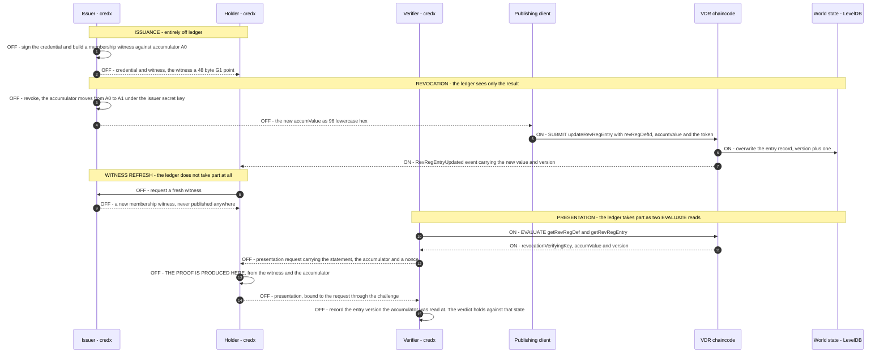
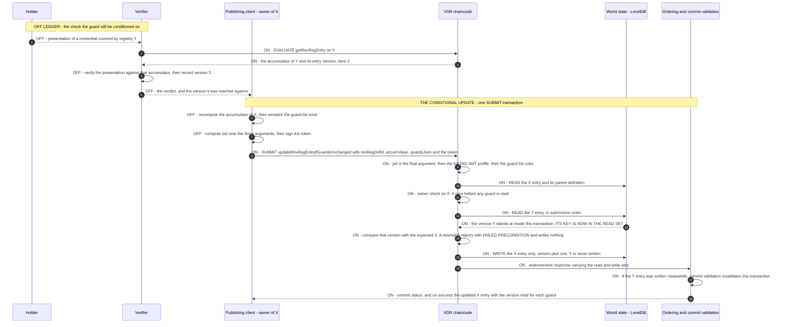

# Hyperledger Fabric AnonCreds Method

**Specification Status:** Editor's Draft

| | |
|---|---|
| **Version** | 0.3.1 |
| **Date** | 2026-10-26 |
| **Verifiable Data Registry** | A Hyperledger Fabric channel running the `VdrContract` chaincode |
| **AnonCreds object model** | AnonCreds v2. No normative v2 object data model exists, so the shapes are pinned to `credx` (see [§2](#2-status-of-this-document)) |
| **Reference implementation** | [`fabric-vdr-core`](https://github.com/snktibor/fabric-vdr-core), the repository that holds this document |
| **Editors** | _To be completed before registry submission._ |
| **Repository** | `docs/anoncreds-method.md` in the `fabric-vdr-core` repository |

> **Object shapes in this specification are pinned to `hyperledger/anoncreds-v2-rs`, crate `credx` version `0.2.1`, commit `691297a7f9ffcc1f51a5d30741086402d64544c9`.** Every encoding and every RECOMMENDED JSON shape below comes from serializing that build's own structures, not from prose. See [§2.4](#24-what-this-specification-pins-instead).

---

## 1. Abstract

This document specifies an AnonCreds objects method for a Hyperledger Fabric verifiable data registry. It defines how a Fabric channel running the `VdrContract` chaincode identifies, publishes and resolves four AnonCreds object types: Schema, Credential Definition, Revocation Registry Definition and Revocation Registry Entry.

Object identifiers are DID URLs rooted at the publishing issuer's DID. Every publication needs a DID-JWT that is bound to the deployment, to the exact transaction it authorizes, and to a single use. Revocation uses the tails-free VB20 pairing-based accumulator of the AnonCreds v2 reference implementation. The registry publishes a single opaque accumulator value, with no revocation bit-string, no status list and no tails file.

AnonCreds v1 methods did not need the scope boundary that this method draws. Under v1, a holder can prove non-revocation from published registry state alone. Under the v2 accumulator scheme specified here, the holder must also obtain a fresh membership witness from the issuer, and that interaction is not a registry operation. This specification therefore covers how a holder discovers the issuer's refresh service, and leaves the refresh protocol itself out of scope ([§9](#9-non-revocation-and-the-witness-refresh-boundary)).

---

## 2. Status of this document

### 2.1 This is an Editor's Draft

This document has not been submitted to the AnonCreds Methods Registry, and the AnonCreds Specification Working Group has not reviewed it. Its only standing is that of an implementation report for the reference implementation it describes.

### 2.2 The registry entry and this specification

The AnonCreds Methods Registry entry and this method specification are separate documents. The registry entry is a short pointer record with a name, a status, the VDR, contact details and a link to a specification. The registry's own template says that the entry "is not the specification itself, just an overview and context about the method". Two of the registered methods list `Specification: To Be Added`.

This document is the method specification. [Appendix A](#appendix-a-draft-registry-entry) has a draft of the matching registry entry. Publishing this document in the registry's Spec-Up toolchain is a packaging step, and it waits until a registry pull request is opened.

### 2.3 The first AnonCreds v2 objects method

All eight methods in the AnonCreds Methods Registry describe AnonCreds v1 objects. A survey of all issues and pull requests in the registry repository found no discussion of v2. The registry entry template has no field for an object-model version, and the registry's introduction limits itself to "AnonCreds objects as defined in the AnonCreds Specification", with a link to the v1 specification.

There is also no normative AnonCreds v2 object data model to conform to:

| Evidence | Finding |
|---|---|
| `spec/anoncreds_methods.md` in the v2 specification | Byte-identical to the v1 chapter apart from five lines of URL updates that v1 received during the organisation move and v2 did not. It still describes the v1 object set, Indy-style deltas, and the "Revocation Status List". |
| `spec/appendix_data_models.md` (v2) | A literal `todo` stub. |
| `data_flow_*.md` (v2) | v1 has seven such files, v2 has none. |
| `spec/crypto.md` (v2) | Headings cover only "Issuer Setup" and CL-signature proving. No BBS, PS, or accumulator content. |
| `terminology.md` (v2) | Still defines Tails File, Revocation Status List and Witness Delta, and has a `TODO` for Non-Revocation Proof. |

A v1 method specification can write "the AnonCreds Schema object" and cite the specification. This one cannot, so it has to define or pin the object shapes itself.

### 2.4 What this specification pins instead

This specification pins the object shapes to the AnonCreds v2 reference implementation, `hyperledger/anoncreds-v2-rs` (crate `credx`), version `0.2.1`, commit `691297a7f9ffcc1f51a5d30741086402d64544c9`. No other anchor exists in practice.

Pinning to an implementation instead of a specification is a weakness of this document, and a stated one. The alternative would be to invent shapes that no implementation produces. The pin can be checked: every encoding and every RECOMMENDED JSON shape in [§8](#8-anoncreds-objects) was obtained by serializing that build's structures with `serde_json`, and anyone can reproduce it from the pinned commit. Where this specification names a `credx` type, field or function, it means the one at that commit.

If the AnonCreds Specification Working Group publishes a normative v2 object data model, the editors should compare the pinned shapes against it and record the result in the changelog of this document.

### 2.5 What is normative in this document

The normative parts are the identifier grammar ([§7](#7-object-identifiers)), the authorization requirements ([§6](#6-issuer-identity-authorization-and-replay-protection)), the wire encodings of `accumValue` and `revocationVerifyingKey` ([§8.1](#81-object-data-model-wire-encodings-and-the-credx-pin)), the `IssuerPublic` reassembly requirements in [§8.1.5](#815-assembling-a-credx-issuerpublic-from-resolved-objects), and the numbered creation and resolution steps in [§8.3](#83-schema) to [§8.6](#86-revocation-registry-entry).

The `publicMetadata` shapes in [§8.1.6](#816-recommended-publicmetadata-shapes) are RECOMMENDED, not enforced. The chaincode validates only that `publicMetadata` is a JSON object. [§11.3](#113-crypto-material-in-unvalidated-metadata-code-gap) records this gap as an open item.

---

## 3. Terminology and conventions

### 3.1 Requirement keywords

The key words MUST, MUST NOT, REQUIRED, SHALL, SHALL NOT, SHOULD, SHOULD NOT, RECOMMENDED, MAY and OPTIONAL in this document are to be interpreted as described in BCP 14 [RFC2119] [RFC8174] when, and only when, they appear in all capitals.

Requirements bind three roles, and the text names the role wherever a requirement appears:

- The publisher is the client that submits a transaction that writes an object.
- The registry is the `VdrContract` chaincode together with the Fabric channel it runs on.
- The resolver is any client that reads objects back, including verifiers and holders.

Where a requirement falls on the resolver because the registry does not enforce it, the text says so at that point.

### 3.2 Terms

**Accumulator.** A single BLS12-381 G1 group element that summarises the set of non-revoked credential identifiers. In this method it is all of the published revocation state.

**Channel.** A Fabric ledger instance with its own world state, block store and membership. One channel is one deployment of this method.

**Chaincode.** The smart contract that runs on Fabric peers, here `VdrContract`.

**credx.** The crate name of `hyperledger/anoncreds-v2-rs`, the AnonCreds v2 reference implementation.

**DID-JWT.** A compact JWT whose `iss` claim is a DID and whose signing key is resolved from that DID's document. [§6.3](#63-did-jwt-profile) gives the profile this method uses.

**EVALUATE / SUBMIT.** Fabric transaction intents. An EVALUATE is a read that one peer executes, without ordering or commit. A SUBMIT is endorsed, ordered and committed, and may write state.

**Membership witness**, also called the revocation handle. The value on the holder's side that proves a credential identifier is still in the accumulator. It is never published to the registry. `credx` calls the type `MembershipWitness` and the credential field `revocation_handle`.

**MVCC validation.** Fabric's check of read-set versions at commit time. Two transactions that read and write the same key concurrently cannot both commit.

**Object identifier.** A DID URL that names one published AnonCreds object, see [§7](#7-object-identifiers).

**VB20.** The pairing-based accumulator of Vitto and Biryukov (eprint 2020/777), implemented at `credx::knox::accumulator::vb20`.

**VDR.** Verifiable data registry, here the Fabric channel together with the `VdrContract` chaincode.

**World state.** The key-value store of current values that each peer maintains, together with a revision history index for each key.

---

## 4. Overview and scope

### 4.1 Goal

The goal is to publish and resolve AnonCreds v2 objects on a permissioned Hyperledger Fabric network, such that:

- every object identifier names its own issuer, and nobody else can mint it;
- every write is authorized by a key the issuer published, and cannot be replayed;
- a verifier can resolve the objects it needs by identifier, without out-of-band coordination, except for the gap recorded in [§11.3](#113-crypto-material-in-unvalidated-metadata-code-gap);
- revocation state is a single accumulator value, with no tails file and no status bit per credential.

### 4.2 Trust model

**Open DID registration.** `createDid` takes no DID-JWT. Any channel member MAY register any syntactically valid DID identifier that is not taken yet. Ownership is self-assigned, first come, first served: the registry sets the DID document's `ownerId` to the DID itself. Every later change is authorized against that self-registered ownership.

Every AnonCreds object identifier is a DID URL rooted at its issuer's DID, so registering a DID also reserves the identifier space under it. [§10.7](#107-open-did-registration-and-identifier-space-squatting) discusses the consequences.

**Network membership is the outer gate.** The reference deployment defines a single organisation and no explicit endorsement policy, so membership in that organisation is the write gate at the Fabric level. The chaincode reads no MSP attributes and makes no authorization decision on the transport identity. All authorization at the application level is the DID-JWT layer of [§6](#6-issuer-identity-authorization-and-replay-protection).

**Reads are unauthenticated.** Every resolution transaction is an EVALUATE read that takes no token. Any channel member can resolve any object.

### 4.3 Conformance to the AnonCreds specification's normative requirements

The AnonCreds specification places three requirements on an objects method. The table shows where this method meets each one:

| Requirement | Where satisfied |
|---|---|
| Identifiers MUST be URIs conformant with [RFC3986] | [§7.2](#72-uri-conformance). Identifiers are DID URLs, which are RFC 3986 URIs. |
| The method MUST define the format of the issuer identifier | [§6.1](#61-issuer-identifiers). |
| The method MUST verify that the publisher of an object controls the issuer identifier before publishing | [§6.8](#68-verifying-publisher-control), enforced by the identifier grammar as described in [§7.7](#77-issuer-control-by-construction). |

The specification also says that a method may normalise deltas or full state "to the RevReg format expected for AnonCreds generate presentation processing". This method cannot act on that guidance, because the target format is the v1 structure of a bit-string plus an accumulator, and nobody has published a v2 equivalent. See [§8.2](#82-deviations-from-anoncreds-v1-object-shapes).

### 4.4 Deviations stated up front

This method departs from the object shapes in the methods chapter of the AnonCreds specification in six ways: no tails files, no revocation bit-string, a revocation scheme token other than `CL_ACCUM`, a different meaning for `maxCredNum`, a signature-scheme indicator on the credential definition, and G2 accumulator key material in place of `accumKey.z`. [§8.2](#82-deviations-from-anoncreds-v1-object-shapes) states each one in full, and the section of the affected object states it again.

### 4.5 Out of scope

- The witness-refresh protocol. This method specifies how to discover the refresh service ([§9.4](#94-discovery-of-the-refresh-service)), and the issuer defines the protocol.
- The DID method. This method works with any DID method ([§6.2](#62-the-did-registry)) and does not define one. The `did:vdr` identifiers in the examples are a deployment convention with no published DID method specification, see [§11.6](#116-didvdr-is-a-deployment-convention).
- Credential issuance, presentation and proof formats. The AnonCreds v2 protocol and its reference implementation govern these.
- Network operation, that is channel configuration, endorsement policy and peer administration.

### 4.6 Universal AnonCreds resolver support

A universal AnonCreds resolver dispatches on the identifier. Every identifier under this method is a DID URL whose DID part carries the method name, so the resolver dispatches on the DID method name together with the `/anoncreds/v2/` path marker. A resolver that recognises the deployment's DID method and can reach a peer of the channel can resolve every object type through the EVALUATE transactions named in [§8](#8-anoncreds-objects). It needs no other resolution metadata.

---

## 5. The Hyperledger Fabric VDR

### 5.1 Channel, chaincode, world state

The registry stores objects in the world state of a Fabric channel, and the `VdrContract` chaincode is the only way to write or read them. Each object type has its own composite-key namespace: `DID`, `SCHEMA`, `CREDDEF`, `REVREGDEF`, `REVREGENTRY`, and `JWTNONCE` for consumed token identifiers. Within a namespace the key is the object identifier.

The peers of the reference deployment use LevelDB as their state database, not CouchDB, and this method is written for LevelDB. This has two consequences. First, there are no rich queries. Every read this method performs is either a point lookup on a key or an ordered range scan over one composite-key namespace. For this reason the `list*` transactions scan a whole namespace, and no transaction selects records by their content. Second, Fabric's phantom-read protection covers the range reads that the method does perform. A range query enters the transaction's read set as a range plus a digest over the results it returned, and commit-time validation checks it again, so a key inserted into that range between simulation and commit invalidates the transaction. A CouchDB rich query would have no such protection, because validation does not evaluate its result set again. Later revisions should therefore keep reads to point lookups and range scans.

### 5.2 SUBMIT and EVALUATE

Every publishing operation is a SUBMIT transaction, which peers endorse, the ordering service orders, and peers then commit. Every resolution operation is an EVALUATE transaction, which runs against the world state of one peer, needs no authentication and writes nothing.

Resolvers MUST account for one consequence of this split. An EVALUATE read reflects the state of the peer that served it. A resolver that reads right after a publish MAY observe the state before the commit, if it queries a peer that has not committed the block yet.

### 5.3 Endorsement, ordering and MVCC

The writes of a SUBMIT transaction take effect only if the transaction passes endorsement and the MVCC validation at commit. Two concurrent transactions whose read sets overlap on a written key cannot both commit. The second one fails validation and writes nothing. This is what serialises concurrent accumulator updates ([§8.6](#86-revocation-registry-entry)) and concurrent use of the same token identifier ([§6.6](#66-one-time-use)).

### 5.4 History index

Fabric keeps a revision history for each key. This method exposes it for one object type only. `getRevRegEntryHistory` returns every accumulator value ever written for a revocation registry definition, oldest first. A verifier uses it to obtain the accumulator value that was current at a past point in time, after later entry updates have overwritten it.

### 5.5 Chaincode events

Every SUBMIT transaction emits exactly one event, which subscribers receive with the committed block. A transaction that fails endorsement or validation delivers nothing, so an observed event always reflects committed state.

| Event | Emitted by | Payload |
|---|---|---|
| `DidCreated` / `DidUpdated` / `DidDeactivated` | the corresponding DID transaction | `{id}` |
| `SchemaCreated` | `createSchema` | `{id, issuerId}` |
| `CredDefCreated` | `createCredDef` | `{id, issuerId, schemaId}` |
| `RevRegDefCreated` | `createRevRegDef` | `{id, issuerId, credDefId}` |
| `RevRegEntryCreated` | `createRevRegEntry` | `{revRegDefId, accumValue, version}` |
| `RevRegEntryUpdated` | `updateRevRegEntry` and `updateRevRegEntryIfGuardsUnchanged` | `{revRegDefId, accumValue, version}` |

`RevRegEntryUpdated` is the event holders MUST watch, because every accumulator change makes a holder's membership witness stale ([§9](#9-non-revocation-and-the-witness-refresh-boundary)). Its payload carries the new accumulator value, so no follow-up query is needed. It carries no timestamp, for the reasons in [§5.6](#56-time).

The two update transactions emit the same event with the same payload on purpose. A subscriber that refreshes witnesses needs to know that the accumulator moved, not which path moved it, and a second event name would leave every such subscriber blind to the registries that use the conditional path. The publisher of a conditional update learns from the transaction response that its guards held, and the registry does not broadcast that fact ([§8.6](#86-revocation-registry-entry)).

### 5.6 Time

The only time value the chaincode can use is the transaction timestamp in the channel header of the submitting client. Every peer computes the same value, which is what makes it usable at all. But the submitter chooses it, and neither the ordering service nor the peers attest it.

The registry uses this value for two purposes: to evaluate DID-JWT time claims ([§6.3](#63-did-jwt-profile)), and to stamp `createdAt` and `updatedAt` on records. It is audit metadata. Resolvers MUST NOT derive freshness or ordering guarantees from it. Within a revocation registry, the entry `version` gives the order. See [§10.5](#105-timestamps-are-client-supplied-and-unattested).

---

## 6. Issuer identity, authorization, and replay protection

### 6.1 Issuer identifiers

The issuer identifier is a DID that conforms to the DID Core syntax:

```
did = "did:" method-name ":" method-specific-id
```

The registry enforces this syntax and nothing more. `method-name` is lowercase alphanumeric. `method-specific-id` is a sequence of colon-separated groups of `idchar` (`ALPHA`, `DIGIT`, `.`, `-`, `_`, or percent-encoded), and its last group is non-empty.

No DID method has special status, so `did:vdr`, `did:web` and `did:key` issuers are all syntactically legal. The syntax check matters: a DID contains no `/`, and that is what lets an object identifier split unambiguously into issuer DID and AnonCreds path at its first slash ([§7.1](#71-grammar)).

An issuer registers its DID on this same registry through `createDid`, and the DID MUST be `ACTIVE` at the time an object is published.

### 6.2 The DID registry

The registry stores DID documents in the `DID` namespace. Registration is open and unauthenticated ([§4.2](#42-trust-model)). The registry validates the shape of the document:

- `verificationMethod` MUST contain at least one entry.
- Every entry MUST be a JSON object with non-empty textual `id`, `type` and `controller`.
- Every entry's `type` MUST be `JsonWebKey2020`.
- Every entry MUST carry a `publicKeyJwk` object with non-empty textual `kty`, `crv`, `x` and `y`, where `kty` is `EC` and `crv` is `P-256`.
- `service` is OPTIONAL. When present, every entry MUST be a JSON object. The registry validates nothing else in a service entry, not `id`, not `type` and not `serviceEndpoint`. [§9.4](#94-discovery-of-the-refresh-service) depends on this.

The requirement that every verification method be `JsonWebKey2020` with EC P-256, and not only the one a token selects, is a restriction of the current implementation.

DID deactivation is irreversible. It permanently disables every JWT-gated operation of that issuer, including accumulator updates on its revocation registries. See [§10.3](#103-key-control-and-irreversible-deactivation).

### 6.3 DID-JWT profile

Every state-changing transaction except `createDid` takes a compact DID-JWT as its last argument. Validation uses only the ledger: the registry makes no external network call and resolves all key material from world state.

A token MUST satisfy all of the following:

1. The JWT MUST have exactly three dot-separated segments, with header and claims segments that are base64url-decodable and each parse as a JSON object.
2. The header `alg` MUST be `ES256`.
3. The header `kid` MUST be present. The registry expands a `kid` that begins with `#` by prefixing the `iss` value.
4. The claim `iss` MUST be a DID that exists in the DID registry and whose status is `ACTIVE`.
5. The `kid` MUST select a `verificationMethod` of that DID document whose `type` is `JsonWebKey2020` and which carries a `publicKeyJwk` object. That JWK MUST be `EC` / `P-256` with 32-byte `x` and `y` coordinates.
6. The signature MUST verify against the resolved key. The key was resolved from the document of the DID named in `iss`, so a valid signature proves that this DID issued the token, and the registry does not check the issuer again.
7. `iat`, `nbf` and `exp` MUST all be present. The registry evaluates them against the transaction timestamp with a clock-skew tolerance of 30 seconds. `iat` MUST NOT be more than the tolerance in the future. The registry does not consult the system clock.
8. `aud` MUST contain the deployment audience ([§6.4](#64-deployment-binding)).
9. The `txd` claim MUST match the transaction digest ([§6.5](#65-transaction-binding)).
10. `jti` MUST be present and MUST NOT have been consumed before ([§6.6](#66-one-time-use)).

Any failure produces an `UNAUTHORIZED` error, and the transaction writes nothing.

### 6.4 Deployment binding

`aud` MUST contain the fixed string:

```
vdr-network:vdrchaincode
```

The registry rejects a token minted for another system, even one signed by the same DID key.

### 6.5 Transaction binding

The `txd` claim binds a token to one specific invocation. It MUST equal:

```
base64url-no-pad( SHA-256( LP(method) || LP(arg₁) || … || LP(argₙ) ) )
```

where `LP(s)` is the 4-byte big-endian length of the UTF-8 encoding of `s`, followed by those bytes. `method` is the plain transaction method name without a contract-name prefix, for example `createSchema`. `arg₁…argₙ` are the string arguments of the transaction in submission order, without the trailing `jwt` argument itself. A numeric parameter contributes the exact wire string the client submits, in canonical decimal.

The length prefixes make the digest input injective. No combination of method and argument values can give the same input as a different combination, whatever the arguments contain.

The registry computes this digest again from the invocation it received, reading the submitted arguments from the transaction stub. It also requires the `jwt` to be the last submitted argument, so the digest always covers exactly the non-JWT arguments the client submitted. A token minted for one operation, or for the same operation with different arguments, is rejected on any other invocation.

**The conditional update.** `updateRevRegEntryIfGuardsUnchanged` ([§8.6](#86-revocation-registry-entry)) uses the same formula, with `method` the literal string `updateRevRegEntryIfGuardsUnchanged` and `arg₁…arg₃` its three non-JWT arguments in submission order: `revRegDefId`, `accumValue`, `guardsJson`. The method name is the first element of the preimage, so a token minted for `updateRevRegEntry` can never authorize the conditional path, and a token minted for the conditional path can never authorize the unconditional one.

It is the first transaction of this method whose digest covers a structured payload, so this section states the rule for it explicitly. **`guardsJson` contributes the exact byte sequence the publisher submits.** This specification defines no canonical form for it. Whitespace, the member order inside a guard object and the order of the array elements are all part of the digest, and neither the publisher nor the registry normalizes any of them before hashing. A publisher therefore MUST serialize the guard list once and MUST sign the same string, byte for byte, that it submits. If a publisher serializes the list a second time on its way to the wire, from the same structure but with different spacing or a different member order, it has signed a digest over a string it does not submit, and the registry rejects every such transaction as `UNAUTHORIZED`.

### 6.6 One-time use

`jti` MUST be present and unique per issuer. After successful validation the registry derives a deterministic nonce key from the length-prefixed `(iss, jti)` pair. The key is a SHA-256 hex digest, so no crafted issuer or `jti` value can collide with another pair. The registry writes a record under that key into the `JWTNONCE` namespace, together with the token's expiry.

If a record for that pair already exists, the registry rejects the transaction as a replay. The read of the absent key is part of the transaction's read set, so Fabric MVCC validation serialises concurrent submissions of the same pair, and only the first one commits.

Replay protection therefore rests on consuming the `jti`, not on token expiry. The reason is that the client supplies the timestamp against which the registry evaluates `exp` ([§5.6](#56-time)). Without `jti` consumption, a malicious client could back-date a transaction to re-enter the validity window of a captured token.

### 6.7 Ownership

Every object record carries an `ownerId`, which the registry sets at creation to the verified signer DID. Only the owner can change an object: the signer DID MUST equal the recorded `ownerId`. Revocation registry entries have no owner of their own. Every authorization decision for an entry reads the `ownerId` of its parent revocation registry definition.

### 6.8 Verifying publisher control

The AnonCreds specification requires a method to verify, before publishing, that the publisher of an object controls the issuer identifier. This method meets that requirement with two checks on every object creation:

1. The object identifier MUST be a DID URL rooted at a syntactically well-formed issuer DID. No object-creating transaction declares an issuer separately. The identifier is the only source, and the registry reads the issuer from it at its first slash ([§7.7](#77-issuer-control-by-construction)).
2. The signer DID resolved from the verified token MUST equal that issuer DID. A mismatch is `UNAUTHORIZED`.

Together the two checks mean that a published identifier always names the DID that authorized it. The proof is the ES256 signature over a transaction-bound, single-use token, verified against a key that this DID published.

---

## 7. Object identifiers

### 7.1 Grammar

Every AnonCreds object identifier is a DID URL rooted at the publishing issuer's DID:

```
<issuer-did> "/anoncreds/v2/" <TYPE> "/" <UUIDv7>
```

| Object type | Identifier format |
|---|---|
| Schema | `<issuer-did>/anoncreds/v2/SCHEMA/<UUIDv7>` |
| Credential definition | `<issuer-did>/anoncreds/v2/PUBLIC_CRED_DEF/<UUIDv7>` |
| Revocation registry definition | `<issuer-did>/anoncreds/v2/REV_REG_DEF/<UUIDv7>` |
| Revocation registry entry | none, addressed through its definition ([§7.6](#76-revocation-registry-entry-addressing)) |

This follows the convention of every DID-bound registered method. `did:indy` writes `<did>/anoncreds/<version>/<TYPE>/<id>`, and the Hiero method writes `<publisher-did>/anoncreds/<version>/<TYPE>/<topic>`.

### 7.2 URI conformance

Identifiers under this method are DID URLs, and therefore URIs that conform to [RFC3986]. This meets the only identifier requirement of the AnonCreds specification.

They are not URNs. A URN has the form `urn:<nid>:<nss>` per [RFC8141] and needs a registered namespace identifier. This method registers and uses no URN namespace, and this document says "DID URL" throughout. No IANA action is required. This matches the AnonCreds specification, whose IANA Considerations section reads in full "This document has no IANA actions."

### 7.3 The version segment

The `v2` segment versions the AnonCreds object shapes, not this method specification. The two registered methods that encode object-family versions use `v0` (`did:indy`, for the legacy Indy-era shapes) and `v1` (Hiero). No registered method uses `v2` yet, and this specification is the first.

The front matter gives the version of this document, and [§13](#13-changelog) is its changelog. The two version numbers are independent and MUST NOT be conflated.

### 7.4 Type tokens

The `<TYPE>` segment MUST be one of `SCHEMA`, `PUBLIC_CRED_DEF`, or `REV_REG_DEF`.

This method uses `PUBLIC_CRED_DEF` instead of the `CLAIM_DEF` token of `did:indy` for two reasons. `CLAIM_DEF` is Indy ledger vocabulary for a CL-signature credential definition, an AnonCreds v1 construct that this method cannot publish, because the allowlist of credential definition types admits only BBS and PS ([§8.2](#82-deviations-from-anoncreds-v1-object-shapes)). And `PUBLIC_CRED_DEF` says what is published: only the public half of the credential definition ever reaches the registry.

### 7.5 The object segment

The last segment MUST be a UUID version 7, matching:

```
^[0-9a-fA-F]{8}-[0-9a-fA-F]{4}-7[0-9a-fA-F]{3}-[89abAB][0-9a-fA-F]{3}-[0-9a-fA-F]{12}$
```

A UUIDv7 contains a Unix timestamp in milliseconds, so identifiers sort by creation time from the identifier alone, without a ledger lookup. The publishing client mints this timestamp, so it has the same trust caveat as every other time value a client supplies ([§5.6](#56-time)).

### 7.6 Revocation registry entry addressing

Revocation registry entries have no identifier of their own. Exactly one entry exists per revocation registry definition, so the DID URL of the definition addresses its entry unambiguously, and the registry stores the entry under that key.

Registered methods handle mutable revocation state the same way. Hiero states that revocation registry entries "do not have an identifier and [are] discovered through associated RevRegDef object". `did:web` notes that status lists "are not typically referenced by their ID but retrieved as the result of a query to the VDR for a given timestamp".

Some registered methods carry a pointer to the mutable state in the metadata of the definition, for example Hiero's `hcsMetadata.entriesTopicId` and `did:web`'s `resourceMetadata.revocationStatusListEndpoint`. They need the pointer because the state lives elsewhere. Here the entry is keyed by the definition's own identifier, so the pointer would always equal that identifier, and no metadata field carries it.

Those methods encode time in an entry identifier or a query parameter. Here `getRevRegEntryHistory` does that job ([§8.6](#86-revocation-registry-entry)).

### 7.7 Issuer control by construction

The issuer DID is part of the object identifier and roots it, so the identifier grammar itself meets the requirement that the publisher controls the issuer. No separate mechanism is needed.

Object-creating transactions take no separate issuer argument, and the identifier is the only source of the issuer. A DID never contains `/` (DID Core), so the identifier splits unambiguously at its first slash. The segment before the slash must itself be a well-formed DID, and that issuer must equal the verified token signer ([§6.8](#68-verifying-publisher-control)). No caller can mint an identifier rooted at a DID it does not control, and no resolver needs a second lookup to learn who published an object, because the identifier names its own issuer.

The `issuerId` field of a resolved record is therefore derived, not declared. The registry writes it at creation from the identifier in the transaction, and a resolver that derives it again from the identifier MUST obtain the same value.

DID-bound methods get this property without extra work, and it is the main reason this method is DID-bound. A method whose identifiers carry no issuer binding needs an explicit mechanism to show a resolver that the publisher controlled `issuerId`. Here the grammar is that mechanism.

### 7.8 Identifiers are client-minted

The registry validates the identifier grammar on creation and never generates an identifier. The publisher chooses the UUIDv7. The registry rejects a duplicate identifier within a namespace, so identifiers are first come, first served within the space that the owner of a DID already controls.

### 7.9 Comparison with registered methods

| Method | Identifier shape | DID-bound |
|---|---|---|
| `did:indy` | `<did>/anoncreds/v0/<TYPE>/<id>` | yes |
| Hiero | `<publisher-did>/anoncreds/v1/<TYPE>/<topic-id>` | yes |
| `did:web` | `<did>?service=<svc>&relativeRef=/<path>/<object-id>` | yes |
| `did:prism`, cheqd, Cardano | DID URLs / DID-Linked Resources | yes |
| Legacy Indy | bare colon-delimited strings (the grandfathered non-URI exception) | no |
| HTTP | plain HTTP URLs | no |
| This method | `<issuer-did>/anoncreds/v2/<TYPE>/<UUIDv7>` | yes |

---

## 8. AnonCreds objects

### 8.1 Object data model, wire encodings, and the credx pin

#### 8.1.1 Encoding principle

For both cryptographic values this method publishes, the compressed byte encoding is the normative layer. Lowercase hexadecimal is the text form of those bytes in this method. It was chosen because the `serde` serialization of the pinned `credx` build produces exactly this form, so a `credx` client can use the value directly, without an adapter.

A future revision MAY define another text form of the same bytes. It MUST NOT change the bytes.

#### 8.1.2 `accumValue`, the VB20 accumulator

The accumulator is a BLS12-381 G1 point. On the wire and on the ledger it is the 48-byte compressed encoding in ZCash format: the x-coordinate in big-endian order, with flag bits in the most significant byte (`0x80` compressed, `0x40` infinity, `0x20` y-sign). It is written as exactly 96 lowercase hexadecimal characters:

```
^[0-9a-f]{96}$
```

This is byte-identical to what `credx` produces for `vb20::Accumulator`. At the pinned commit, serializing the `revocation_registry` field of an `IssuerPublic` with `serde_json` yields a bare JSON string of exactly 96 lowercase hex characters.

#### 8.1.3 `revocationVerifyingKey`, the VB20 verifying key

The accumulator verifying key is a BLS12-381 G2 point, written as its 96-byte compressed encoding in exactly 192 lowercase hexadecimal characters:

```
^[0-9a-f]{192}$
```

This is `credx`'s `IssuerPublic.revocation_verifying_key` (`vb20::PublicKey`), which also serializes as a bare JSON string of 192 lowercase hex characters.

#### 8.1.4 Validation scope

On chain, the registry validates only the format of both values: the length, the lowercase hex character set, and that the compression flag is set. It rejects the identity element, which has the infinity flag set, because neither an accumulator nor a verifying key is ever legitimately the identity.

The registry rejects uppercase hex, `0x` prefixes, base64 and uncompressed encodings, which keeps the canonical ledger JSON byte-stable.

The registry does not verify that a value decodes to a point on the curve, or that the point lies in the correct prime-order subgroup. Those checks need a pairing library, and the chaincode does not carry one, by design. **Resolvers MUST perform the on-curve and subgroup-membership checks themselves.** A `credx` client already gets them, because the reference deserializer enforces membership on every read.

#### 8.1.5 Assembling a `credx` `IssuerPublic` from resolved objects

A verifier needs a complete `IssuerPublic` to verify any presentation. This method spreads its fields over three resolved objects:

| `credx` `IssuerPublic` field | Source in this method | Status |
|---|---|---|
| `id` | `CredDef.publicMetadata.id` | RECOMMENDED, unvalidated |
| `schema` | `CredDef.publicMetadata.schema` | RECOMMENDED, unvalidated |
| `verifying_key` | `CredDef.publicMetadata.verifying_key` | RECOMMENDED, unvalidated |
| `verifiable_encryption_key` | `CredDef.publicMetadata.verifiable_encryption_key` | RECOMMENDED, unvalidated |
| `revocation_verifying_key` | `RevRegDef.publicKeys.revocationVerifyingKey` | first-class, format-validated |
| `revocation_registry` | `RevRegEntry.accumValue` | first-class, format-validated |

All six fields contribute to the Merlin transcript that produces the proof challenge. `IssuerPublic::add_challenge_contribution` appends the issuer id, the verifying key, the revocation verifying key, the accumulator, the verifiable encryption key, and then the whole schema, claim by claim, including the label, type, print-friendly flag and validators of each claim.

These values MUST therefore be reproduced byte for byte, or verification fails. Several of them cannot be derived from anything else on the ledger. `credx`'s `IssuerPublic.id` and `CredentialSchema.id` are random 16-byte hex handles, and `CredentialSchema.label` and `description` are unrelated to this method's `Schema.name` and `Schema.version`. A resolver that reads only first-class record fields cannot verify a presentation.

**Reassembly recipe.** Take the resolved `CredDef.publicMetadata`, insert `revocation_verifying_key` from the revocation registry definition and `revocation_registry` from the revocation registry entry, and deserialize the completed document as `IssuerPublic<BbsScheme>`, or as `IssuerPublic<PsScheme>` if `CredDef.type` says so. No field needs renaming or restructuring, because the RECOMMENDED shape uses `credx`'s own serde field names for exactly this purpose.

**The completed document MUST be deserialized from JSON text, not from an in-memory `serde_json::Value`.** A resolver MUST pass the assembled JSON to `serde_json::from_str` or `serde_json::from_slice`. It can insert the two fields into the `publicMetadata` bytes as they arrived, or serialize an assembled tree back to text first. `serde_json::from_value` does not work for this recipe. It fails on the first curve point with `invalid type: string "…", expected a borrowed string`. Every BLS12-381 point in the document deserializes through the human-readable path of `blstrs_plus`: the accumulator, the revocation verifying key, each `verifying_key.y` entry and the verifiable encryption key. That path asks for a borrowed `&str` (`blstrs_plus` 0.8.18 `src/serde_impl.rs:118`, as resolved by the pinned `credx` build), and an owned `Value` can only give the visitor a temporary one. Parsing text costs a resolver nothing extra, because it already holds the response bytes of the registry.

#### 8.1.6 RECOMMENDED `publicMetadata` shapes

> **Status: RECOMMENDED, not enforced.** The registry validates only that `publicMetadata` is a JSON object. It does not check field names, types, hex lengths, curve membership, or consistency with the referenced schema. A publisher can write anything object-shaped, and resolvers MUST treat the contents as unvalidated data supplied by the issuer. See [§11.3](#113-crypto-material-in-unvalidated-metadata-code-gap).

The shape below follows the `credx` structures at the recorded commit and matches their serialization exactly. It is the serialization of a real `IssuerPublic` with the two first-class fields removed.

```json
{
  "id": "253bf2c04b110671b6368aabde15fd61",
  "schema": {
    "id": "ec4ba6ad8a7a0736408b08a4aec4e391",
    "label": "Resident Card",
    "description": "Example schema for the Fabric VDR AnonCreds method specification",
    "blind_claims": ["givenName"],
    "claim_indices": ["credentialId", "givenName", "birthYear"],
    "claims": [
      { "claim_type": "Revocation", "label": "credentialId", "print_friendly": false },
      { "claim_type": "Hashed", "label": "givenName", "print_friendly": true,
        "validators": [{ "Length": { "min": 1, "max": 64 } }] },
      { "claim_type": "Number", "label": "birthYear", "print_friendly": true,
        "validators": [{ "Range": { "min": 1900, "max": 2025 } }] }
    ]
  },
  "verifying_key": {
    "y": [
      "8df00c58767f872b7f7f2344fa4f893e3bc11674264f577d5bcca4c7cf2da666b4535abd20cafcc49ac4ce0ba29bbd6e",
      "b72ebf7b396b33bc8e2cdaa50908b671d7742c0b2fd52fb44d01c033378f004427ffc54db1cca6f073bfa608b6735f6e",
      "a1c37793230c08791d3c376e403ca1f3fa317477e22e0b56e1bf26076e8f4e80f8fa472a7c8ed5e57d73a5655dcd9578"
    ],
    "w": "a1135043a6e1f18210d58735e646dc18f6d1de519e4e6b2093c0086abd057414cafd18d824ff5a4493635d6f9e6bef5412bacc2385b05d1e8c48ffcb3e06f45ea2c76eb28e0515dfb317959934de86768462f3af759c085226423e2ee98228c0"
  },
  "verifiable_encryption_key": "86a43dd0fd83663b4555ffb8b7fab2570e731cb914598346034643a9a5f46761a61521147b6d00b2f6a7a6b7d1cbf2a3"
}
```

Notes on the shape, all checked against the pinned build:

- `claim_type` is one of `Unknown`, `Hashed`, `Number`, `Scalar`, `Revocation`, `Enumeration`, serialized as the variant name.
- `validators` is left out when it is empty. Variants are externally tagged, as in `{"Length": {…}}`, `{"Range": {…}}`, `{"Regex": {…}}` and `{"AnyOne": {…}}`, and absent bounds are left out instead of being null.
- `verifying_key.y` holds one 96-hex G1 point per claim, because the signing key is generated with size `schema.claims.len()`. `w` is a 192-hex G2 point. The three `y` entries above correspond to the three claims.
- `verifiable_encryption_key` is a 96-hex G1 point.
- `blind_claims` and `claim_indices` are ordered arrays, and `claim_indices` gives the authoritative claim order.

Consistency requirements on a conforming publisher. The chaincode enforces none of them:

1. `publicMetadata.schema.claim_indices` SHOULD equal the referenced `Schema.attrNames`, in the same order.
2. When the credential definition is used with a revocation registry, `publicMetadata.schema.claims` MUST contain exactly one claim with `claim_type: "Revocation"`. Without it, revocation cannot be set up at all.
3. `publicMetadata.verifying_key.y` SHOULD have exactly as many entries as `publicMetadata.schema.claims`.
4. The signature scheme implied by `verifying_key` MUST match the credential definition's `type`.

A future revision could promote these fields to first-class, validated record fields. That would be a compatible change: the field names and encodings would stay the same, and a resolver that implements the reassembly recipe above would keep working. [§11.3](#113-crypto-material-in-unvalidated-metadata-code-gap) records this.

### 8.2 Deviations from AnonCreds v1 object shapes

The methods chapter of AnonCreds v2 is unrevised v1 text ([§2.3](#23-the-first-anoncreds-v2-objects-method)), so a reviewer who reads this method against the published specification will find six slots that do not map. This section states each one, and the section of the affected object states it again.

| v1 slot | Status here | Why |
|---|---|---|
| `tailsLocation`, `tailsHash` | Absent | VB20 is tails-free. |
| `revocationList` bit array | Absent | Revocation state is one accumulator value. |
| `revocDefType: "CL_ACCUM"` | Replaced | The scheme is not CL. |
| `maxCredNum` | Retained, with a new meaning | The v1 meaning does not carry over. |
| Signature-scheme indication | Added | v1 has no slot for it. |
| `accumKey.z` | Replaced | The pairing-based scheme needs different public material. |

**No tails files.** The VB20 accumulator needs no tails file. A holder proves non-revocation with a membership witness against the accumulator, not with an index into a precomputed array. `tailsLocation` and `tailsHash` would have nothing to point at, so both fields are absent from the revocation registry definition. Some methods give a whole section to generating and hosting tails files, and others carry the fields while stating that they do not manage the files. Neither problem arises here.

**No revocation bit-string or status list.** The v1 Revocation Status List object is a bit array of length `maxCredNum`, with one bit per credential index. That object does not apply here. Under this method the published revocation state is a single opaque group element. The ledger holds no index per credential, nothing that can be enumerated, and no object that corresponds to a status list. A bit-string would also bring back a v1 construct that allows correlation, since a verifier could learn which index a holder occupies.

The v1 guidance about normalising deltas or full state "to the RevReg format expected for AnonCreds generate presentation processing" assumes that bit-string-plus-accumulator target format. No v2 equivalent has been published, so this method cannot follow the guidance and does not try to.

**`revocDefType` is not `CL_ACCUM`.** The AnonCreds specification says this field "is currently always `CL_ACCUM`". The equivalent field of this method, `RevRegDef.type`, carries `ANONCREDS_V2/VB20/1.0`.

This method invented that token. No authority allocates identifiers for v2 revocation schemes. There is no registry of `revocDefType` values, and the reference implementation defines no wire-level scheme constant: serde tags its statements by Rust type name, and its only scheme strings are domain-separation labels in the Merlin transcript. This method therefore namespaces its own tokens as `<family>/<scheme-token>/<version>`, where the scheme token is the module name in the reference implementation (`credx::knox::accumulator::vb20`), the only stable name it offers.

If the Working Group defines a canonical identifier, it can join the allowlist next to this one, and this one can be retired. The registry checks the value against an allowlist, never a blocklist, so it rejects retired and foreign scheme names, `CL_ACCUM` included. See [§11.1](#111-no-allocation-authority-for-v2-scheme-tokens).

**`maxCredNum` means something different.** In v1 this field is the length of the tails array, and therefore a hard cryptographic bound on the capacity of the registry. **Under VB20 it has no cryptographic meaning.** The `RevocationRegistry` of the reference implementation keeps its elements in an unbounded `IndexSet`, and nothing in the scheme limits how many elements the accumulator holds.

The field stays as a capacity statement by the issuer: a published, immutable declaration of how many credentials the issuer intends this registry to track. The registry only enforces that it is greater than zero. It never counts credentials against it, because credentials are not published and no credential count exists on chain. Resolvers MUST NOT treat it as a guarantee.

**The credential definition carries the signature scheme.** AnonCreds v2 supports more than one signature scheme. v1 had no slot for the scheme of a credential definition, because CL was the only one. Here `CredDef.type` carries it, and an allowlist limits it to `ANONCREDS_V2/BBS/1.0` (`credx::knox::bbs`) or `ANONCREDS_V2/PS/1.0` (`credx::knox::ps`). As with the revocation token, this method invented these values and no authority allocates them.

**The accumulator public material is a G2 verifying key.** v1 puts a single `accumKey.z` in the revocation registry definition. The pairing-based scheme here needs different material. `RevRegDef.publicKeys` carries exactly one field, `revocationVerifyingKey`, which holds a compressed BLS12-381 G2 point ([§8.1.3](#813-revocationverifyingkey-the-vb20-verifying-key)). The registry rejects payloads with missing, extra or non-string fields, so the slot has one fixed shape.

---

### 8.3 Schema

A schema declares the attribute set of a credential. Published schemas are immutable: no transition exists to update or deactivate one.

#### Creation and publishing

1. The publisher MUST mint an identifier of the form `<issuer-did>/anoncreds/v2/SCHEMA/<UUIDv7>`, rooted at the DID it controls.
2. The publisher MUST construct and sign a DID-JWT that meets every requirement of [§6.3](#63-did-jwt-profile), with `txd` computed over the method name `createSchema` and the four non-JWT arguments in submission order.
3. The publisher MUST submit `createSchema(id, name, version, attrNamesJson, jwt)` with the token as the last argument. The registry MUST reject the transaction if the last submitted argument is not the token.
4. The registry MUST verify the token and resolve the signer DID: `ES256`, a `kid` that selects a `JsonWebKey2020` EC P-256 verification method of an `ACTIVE` issuer, a valid signature, and `iat` / `nbf` / `exp` satisfied against the transaction timestamp within the 30-second tolerance.
5. The registry MUST verify deployment and transaction binding: `aud` contains `vdr-network:vdrchaincode`, and `txd` equals the digest computed again from the invoked method and its submitted arguments.
6. The registry MUST consume the token: `jti` MUST be present, MUST NOT already be recorded for this issuer, and MUST be written into the `JWTNONCE` namespace as part of the write set of this transaction.
7. The registry MUST validate that `id` carries the `/anoncreds/v2/` path and the `SCHEMA` type token, and ends in a valid UUIDv7.
8. The registry MUST read the issuer DID out of `id`, which is the segment before its first `/`, and MUST validate that it is a syntactically well-formed DID. The transaction declares no issuer of its own ([§7.7](#77-issuer-control-by-construction)).
9. The registry MUST validate the payload: `name` and `version` are non-blank after trimming, and `attrNames` is a non-empty JSON array of unique, non-blank strings whose input order is preserved.
10. The registry MUST reject the transaction as `UNAUTHORIZED` unless the issuer DID read out of `id` equals the signer DID.
11. The registry MUST reject the transaction as `ALREADY_EXISTS` if a schema with this identifier is already present.
12. The registry MUST reject the transaction unless the issuer DID exists and its status is `ACTIVE`.
13. The registry MUST persist the record with `issuerId` set to the DID read out of `id`, `ownerId` set to the signer DID, and `createdAt` set to the transaction timestamp, overwriting any value the client supplied.
14. The registry MUST emit `SchemaCreated` with `{id, issuerId}`.
15. The transaction MUST be endorsed, ordered, and pass MVCC validation before any of the above takes effect. A transaction that fails at any point writes nothing and emits nothing.

#### Resolution

1. A resolver MUST address the schema by its full DID URL.
2. A resolver MUST invoke `getSchema(id)` as an EVALUATE transaction. No token is required.
3. The registry MUST reject a blank identifier as `INVALID_ARGUMENT`.
4. The registry MUST look up the trimmed identifier as an exact key in the `SCHEMA` namespace. The registry normalises nothing beyond trimming, and does not validate the identifier grammar again on read.
5. The registry MUST return `NOT_FOUND` if no record exists under that key.
6. The registry MUST return the record as canonical, deterministically ordered JSON.
7. A resolver SHOULD confirm that the returned `issuerId` roots the requested identifier. The registry enforced this at creation, and the read path does not check it again.
8. A resolver MUST NOT infer from a successful read that the issuer DID is still `ACTIVE`. Resolution performs no check of the issuer status, so a schema published by a DID that was later deactivated still resolves. A resolver that needs to know whether the issuer is still active MUST resolve the issuer DID separately.
9. A resolver MUST NOT expect claim typing from this object. `attrNames` carries ordered labels only. The `credx` claim types needed to build a `CredentialSchema` are in the `publicMetadata` of the credential definition ([§8.1.5](#815-assembling-a-credx-issuerpublic-from-resolved-objects)).

#### Example

Issuer DID:

```
did:vdr:018f6c02-3a5e-7cbb-9d3e-5f2a4b6c8d0e
```

Schema identifier:

```
did:vdr:018f6c02-3a5e-7cbb-9d3e-5f2a4b6c8d0e/anoncreds/v2/SCHEMA/018f6c05-1b22-7aa0-8c31-9e77d0f6a4b1
```

Resolved record:

```json
{
  "attrNames": ["credentialId", "givenName", "birthYear"],
  "createdAt": "2026-08-13T09:14:22.317Z",
  "id": "did:vdr:018f6c02-3a5e-7cbb-9d3e-5f2a4b6c8d0e/anoncreds/v2/SCHEMA/018f6c05-1b22-7aa0-8c31-9e77d0f6a4b1",
  "issuerId": "did:vdr:018f6c02-3a5e-7cbb-9d3e-5f2a4b6c8d0e",
  "name": "Resident Card",
  "ownerId": "did:vdr:018f6c02-3a5e-7cbb-9d3e-5f2a4b6c8d0e",
  "version": "1.0"
}
```

The `attrNames` order matches the `claim_indices` order of the `credx` `CredentialSchema` published in the metadata of the credential definition ([§8.4](#84-credential-definition)).

---

### 8.4 Credential definition

A credential definition binds an issuer, a schema and a signature scheme, and publishes the public key material a verifier needs. Published credential definitions are immutable: no transition exists to update or deactivate one.

#### Creation and publishing

1. The publisher MUST mint an identifier of the form `<issuer-did>/anoncreds/v2/PUBLIC_CRED_DEF/<UUIDv7>`, rooted at the DID it controls.
2. The publisher MUST construct and sign a DID-JWT per [§6.3](#63-did-jwt-profile), with `txd` computed over `createCredDef` and the five non-JWT arguments in submission order.
3. The publisher MUST submit `createCredDef(id, schemaId, type, tag, publicMetadataJson, jwt)` with the token as the last argument.
4. The registry MUST verify the token and resolve the signer DID, as in step 4 of [§8.3](#83-schema).
5. The registry MUST verify deployment and transaction binding (`aud`, `txd`).
6. The registry MUST consume the token identifier (`jti`).
7. The registry MUST validate that `id` carries the `PUBLIC_CRED_DEF` type token and a valid UUIDv7 object segment.
8. The registry MUST read the issuer DID out of `id` and MUST validate that it is a well-formed DID ([§7.7](#77-issuer-control-by-construction)).
9. The registry MUST validate that `schemaId` and `tag` are non-blank, and that `publicMetadataJson` parses as a JSON object. The registry validates nothing else in it, see [§8.1.6](#816-recommended-publicmetadata-shapes).
10. The registry MUST validate `type` against the allowlist of credential definition types: `ANONCREDS_V2/BBS/1.0` or `ANONCREDS_V2/PS/1.0`. Any other value, including the v1 `CL` family, is `INVALID_ARGUMENT`.
11. The registry MUST reject the transaction as `UNAUTHORIZED` unless the issuer DID read out of `id` equals the signer DID.
12. The registry MUST reject the transaction as `ALREADY_EXISTS` if the identifier is already present.
13. The registry MUST reject the transaction as `NOT_FOUND` unless the referenced schema exists. The registry does not constrain the issuer of the schema. A credential definition MAY reference a schema that a different issuer published, which is what makes schemas reusable.
14. The registry MUST reject the transaction unless the issuer DID exists and is `ACTIVE`.
15. The registry MUST persist the record with `issuerId` set to the DID read out of `id`, `ownerId` set to the signer DID, and `createdAt` set to the transaction timestamp.
16. The registry MUST emit `CredDefCreated` with `{id, issuerId, schemaId}`.
17. The transaction MUST be endorsed, ordered, and pass MVCC validation.

#### Resolution

1. A resolver MUST address the credential definition by its full DID URL.
2. A resolver MUST invoke `getCredDef(id)` as an EVALUATE transaction.
3. The registry MUST reject a blank identifier as `INVALID_ARGUMENT`.
4. The registry MUST look up the trimmed identifier as an exact key in the `CREDDEF` namespace.
5. The registry MUST return `NOT_FOUND` if no record exists.
6. The registry MUST return the record as canonical JSON.
7. A resolver SHOULD confirm that the returned `issuerId` roots the requested identifier, and MUST NOT infer from a successful read that the issuer is still active.
8. A resolver MUST resolve the referenced `schemaId` before use, and SHOULD confirm that the `attrNames` of the schema match the claim order in the metadata.
9. A resolver MUST treat `publicMetadata` as unvalidated data supplied by the issuer. The registry checked only that it is a JSON object. It verified no field names, no hex lengths, no curve membership, and no consistency with the referenced schema or with `type`. A resolver MUST perform those checks itself before it uses any key material it finds there.
10. To verify a presentation, a resolver MUST assemble a complete `IssuerPublic` as described in [§8.1.5](#815-assembling-a-credx-issuerpublic-from-resolved-objects). A credential definition resolved alone is not enough.

#### Example

Credential definition identifier:

```
did:vdr:018f6c02-3a5e-7cbb-9d3e-5f2a4b6c8d0e/anoncreds/v2/PUBLIC_CRED_DEF/018f6c07-4d19-7b52-a0f4-3c81e5b90d67
```

Resolved record, with the RECOMMENDED metadata shape of [§8.1.6](#816-recommended-publicmetadata-shapes) shortened in the key material only:

```json
{
  "createdAt": "2026-08-13T09:16:04.882Z",
  "id": "did:vdr:018f6c02-3a5e-7cbb-9d3e-5f2a4b6c8d0e/anoncreds/v2/PUBLIC_CRED_DEF/018f6c07-4d19-7b52-a0f4-3c81e5b90d67",
  "issuerId": "did:vdr:018f6c02-3a5e-7cbb-9d3e-5f2a4b6c8d0e",
  "ownerId": "did:vdr:018f6c02-3a5e-7cbb-9d3e-5f2a4b6c8d0e",
  "publicMetadata": {
    "id": "253bf2c04b110671b6368aabde15fd61",
    "schema": {
      "id": "ec4ba6ad8a7a0736408b08a4aec4e391",
      "label": "Resident Card",
      "description": "Example schema for the Fabric VDR AnonCreds method specification",
      "blind_claims": ["givenName"],
      "claim_indices": ["credentialId", "givenName", "birthYear"],
      "claims": [
        { "claim_type": "Revocation", "label": "credentialId", "print_friendly": false },
        { "claim_type": "Hashed", "label": "givenName", "print_friendly": true,
          "validators": [{ "Length": { "min": 1, "max": 64 } }] },
        { "claim_type": "Number", "label": "birthYear", "print_friendly": true,
          "validators": [{ "Range": { "min": 1900, "max": 2025 } }] }
      ]
    },
    "verifying_key": {
      "y": [
        "8df00c58767f872b7f7f2344fa4f893e3bc11674264f577d5bcca4c7cf2da666b4535abd20cafcc49ac4ce0ba29bbd6e",
        "b72ebf7b396b33bc8e2cdaa50908b671d7742c0b2fd52fb44d01c033378f004427ffc54db1cca6f073bfa608b6735f6e",
        "a1c37793230c08791d3c376e403ca1f3fa317477e22e0b56e1bf26076e8f4e80f8fa472a7c8ed5e57d73a5655dcd9578"
      ],
      "w": "a1135043a6e1f18210d58735e646dc18f6d1de519e4e6b2093c0086abd057414cafd18d824ff5a4493635d6f9e6bef5412bacc2385b05d1e8c48ffcb3e06f45ea2c76eb28e0515dfb317959934de86768462f3af759c085226423e2ee98228c0"
    },
    "verifiable_encryption_key": "86a43dd0fd83663b4555ffb8b7fab2570e731cb914598346034643a9a5f46761a61521147b6d00b2f6a7a6b7d1cbf2a3"
  },
  "schemaId": "did:vdr:018f6c02-3a5e-7cbb-9d3e-5f2a4b6c8d0e/anoncreds/v2/SCHEMA/018f6c05-1b22-7aa0-8c31-9e77d0f6a4b1",
  "tag": "resident-card-2026",
  "type": "ANONCREDS_V2/BBS/1.0"
}
```

`type` is `ANONCREDS_V2/BBS/1.0`, so the `verifying_key` is a BBS key and the reassembly in [§8.1.5](#815-assembling-a-credx-issuerpublic-from-resolved-objects) targets `IssuerPublic<BbsScheme>`. The three `y` entries correspond to the three claims.

---

### 8.5 Revocation registry definition

A revocation registry definition publishes the parameters and public key material of one revocation registry. Published definitions are immutable: no transition exists to update or deactivate one. The mutable revocation state is in the associated entry ([§8.6](#86-revocation-registry-entry)).

#### Creation and publishing

1. The publisher MUST mint an identifier of the form `<issuer-did>/anoncreds/v2/REV_REG_DEF/<UUIDv7>`, rooted at the DID it controls.
2. The publisher MUST construct and sign a DID-JWT per [§6.3](#63-did-jwt-profile), with `txd` computed over `createRevRegDef` and the five non-JWT arguments in submission order. `maxCredNum` contributes the exact decimal wire string submitted.
3. The publisher MUST submit `createRevRegDef(id, credDefId, type, publicKeysJson, maxCredNum, jwt)` with the token as the last argument.
4. The registry MUST verify the token and resolve the signer DID.
5. The registry MUST verify deployment and transaction binding (`aud`, `txd`).
6. The registry MUST consume the token identifier (`jti`).
7. The registry MUST validate that `id` carries the `REV_REG_DEF` type token and a valid UUIDv7 object segment.
8. The registry MUST read the issuer DID out of `id` and MUST validate that it is a well-formed DID ([§7.7](#77-issuer-control-by-construction)).
9. The registry MUST validate that `credDefId` is non-blank.
10. The registry MUST validate `type` against the revocation allowlist, which admits exactly one value: `ANONCREDS_V2/VB20/1.0`. `CL_ACCUM` and every other foreign token are `INVALID_ARGUMENT` ([§8.2](#82-deviations-from-anoncreds-v1-object-shapes)).
11. The registry MUST validate `publicKeys` as a JSON object with exactly one field, `revocationVerifyingKey`, whose value is a string matching `^[0-9a-f]{192}$` with the compression flag set and the infinity flag clear. Missing, extra, or non-string fields are `INVALID_ARGUMENT`.
12. The registry MUST reject `maxCredNum` unless it is greater than zero. The registry checks no other bound, and the value has no cryptographic meaning ([§8.2](#82-deviations-from-anoncreds-v1-object-shapes)).
13. The registry MUST reject the transaction as `UNAUTHORIZED` unless the issuer DID read out of `id` equals the signer DID.
14. The registry MUST reject the transaction as `ALREADY_EXISTS` if the identifier is already present.
15. The registry MUST reject the transaction as `NOT_FOUND` unless the referenced credential definition exists, and MUST reject it as `INVALID_ARGUMENT` unless the `issuerId` of that credential definition equals the issuer DID read out of `id`. Unlike the schema reference in [§8.4](#84-credential-definition), a revocation registry MUST be published by the same issuer as the credential definition it revokes against.
16. The registry MUST reject the transaction unless the issuer DID exists and is `ACTIVE`.
17. The registry MUST persist the record with `issuerId` set to the DID read out of `id`, `ownerId` set to the signer DID, and `createdAt` set to the transaction timestamp. Every later entry operation is authorized against this `ownerId` ([§6.7](#67-ownership)).
18. The registry MUST emit `RevRegDefCreated` with `{id, issuerId, credDefId}`.
19. The transaction MUST be endorsed, ordered, and pass MVCC validation.
20. The published definition MUST be treated as immutable from then on. No transaction exists to update or deactivate it.

No step of this sequence generates, hosts or references a tails file. The definition also carries no pointer to the mutable revocation state, because the entry is keyed by the identifier of this definition ([§7.6](#76-revocation-registry-entry-addressing)).

#### Resolution

1. A resolver MUST address the definition by its full DID URL.
2. A resolver MUST invoke `getRevRegDef(id)` as an EVALUATE transaction.
3. The registry MUST reject a blank identifier as `INVALID_ARGUMENT`.
4. The registry MUST look up the trimmed identifier as an exact key in the `REVREGDEF` namespace.
5. The registry MUST return `NOT_FOUND` if no record exists.
6. The registry MUST return the record as canonical JSON.
7. A resolver SHOULD confirm that the returned `issuerId` roots the requested identifier, and MUST NOT infer from a successful read that the issuer is still active.
8. A resolver MUST decode `publicKeys.revocationVerifyingKey` and check that it is on the curve and in the correct subgroup. The registry validated only its format ([§8.1.4](#814-validation-scope)).
9. A resolver MUST find the current accumulator through the identifier of this definition, by resolving the associated entry ([§8.6](#86-revocation-registry-entry)).
10. A holder MUST also discover the witness-refresh service of the issuer, which is not part of this object. See [§9.4](#94-discovery-of-the-refresh-service).

#### Example

Revocation registry definition identifier:

```
did:vdr:018f6c02-3a5e-7cbb-9d3e-5f2a4b6c8d0e/anoncreds/v2/REV_REG_DEF/018f6c0a-9e33-7f41-b6d2-71c40a8e2f95
```

Resolved record:

```json
{
  "createdAt": "2026-08-13T09:18:41.045Z",
  "credDefId": "did:vdr:018f6c02-3a5e-7cbb-9d3e-5f2a4b6c8d0e/anoncreds/v2/PUBLIC_CRED_DEF/018f6c07-4d19-7b52-a0f4-3c81e5b90d67",
  "id": "did:vdr:018f6c02-3a5e-7cbb-9d3e-5f2a4b6c8d0e/anoncreds/v2/REV_REG_DEF/018f6c0a-9e33-7f41-b6d2-71c40a8e2f95",
  "issuerId": "did:vdr:018f6c02-3a5e-7cbb-9d3e-5f2a4b6c8d0e",
  "maxCredNum": 10000,
  "ownerId": "did:vdr:018f6c02-3a5e-7cbb-9d3e-5f2a4b6c8d0e",
  "publicKeys": {
    "revocationVerifyingKey": "8a2e4375a8be978740b283dd13127c3be0c0b19ed2397eb41bfced51221b77223c532776be78305e6309c99d6fe6ba13002e7a385a7714f3a5bc9f212b7d64ecaaccfa37b3be2c04e286ea272f71ceb98eb88c52d07736d6ba06fb80c99ef368"
  },
  "type": "ANONCREDS_V2/VB20/1.0"
}
```

The verifying key is a real compressed BLS12-381 G2 point that the pinned `credx` build produced. Its leading byte `0x8a` has the compression bit set and the infinity bit clear, as the format check requires. The record has no `tailsLocation` or `tailsHash` field, and `maxCredNum: 10000` is a declaration by the issuer, not an enforced bound.

---

### 8.6 Revocation registry entry

The entry holds the current accumulator value of exactly one revocation registry definition. It is the only mutable object type in this method, and the only one without an identifier of its own.

#### Creation and publishing

1. The publisher MUST address the entry by the identifier of its parent revocation registry definition. The entry has no identifier of its own, and exactly one entry exists per definition ([§7.6](#76-revocation-registry-entry-addressing)).
2. The publisher MUST compute the genesis accumulator value off chain and encode it per [§8.1.2](#812-accumvalue-the-vb20-accumulator). The registry performs no accumulator cryptography.
3. The publisher MUST construct and sign a DID-JWT per [§6.3](#63-did-jwt-profile), with `txd` computed over `createRevRegEntry` and the two non-JWT arguments in submission order.
4. The publisher MUST submit `createRevRegEntry(revRegDefId, accumValue, jwt)` with the token as the last argument.
5. The registry MUST verify the token and resolve the signer DID.
6. The registry MUST verify deployment and transaction binding (`aud`, `txd`).
7. The registry MUST consume the token identifier (`jti`).
8. The registry MUST reject a blank `revRegDefId` as `INVALID_ARGUMENT`.
9. The registry MUST validate `accumValue` against `^[0-9a-f]{96}$` with the compression flag set and the infinity flag clear, and MUST reject anything else as `INVALID_ARGUMENT`. The registry performs no on-curve or subgroup checks ([§8.1.4](#814-validation-scope)).
10. The registry MUST reject the transaction as `NOT_FOUND` unless the parent revocation registry definition exists.
11. The registry MUST reject the transaction as `UNAUTHORIZED` unless the signer DID equals the recorded `ownerId` of the parent definition. The entry has no owner of its own.
12. The registry MUST reject the transaction as `ALREADY_EXISTS` if an entry already exists for this definition.
13. The registry MUST persist the entry at `version` 0, with `createdAt` and `updatedAt` set to the transaction timestamp.
14. The registry MUST emit `RevRegEntryCreated` with `{revRegDefId, accumValue, version}`.
15. The transaction MUST be endorsed, ordered, and pass MVCC validation.

#### Updating the published accumulator

A revocation replaces this value, and does nothing else. No other object in this method is mutable, so this subsection applies to the entry only.

1. The issuer MUST compute the accumulator again off chain after removing the revoked elements, and encode the result per [§8.1.2](#812-accumvalue-the-vb20-accumulator).
2. The publisher MUST construct and sign a fresh DID-JWT per [§6.3](#63-did-jwt-profile), with `txd` computed over `updateRevRegEntry` and the two non-JWT arguments. A token minted for `createRevRegEntry`, or for a different accumulator value, does not validate.
3. The publisher MUST submit `updateRevRegEntry(revRegDefId, accumValue, jwt)` with the token as the last argument.
4. The registry MUST verify the token and the deployment and transaction binding, and MUST consume the token identifier.
5. The registry MUST reject a blank `revRegDefId`, and MUST validate `accumValue` exactly as on creation.
6. The registry MUST reject the transaction as `NOT_FOUND` unless an entry already exists for the definition.
7. The registry MUST reject the transaction as `NOT_FOUND` unless the parent definition exists, and as `UNAUTHORIZED` unless the signer DID equals the recorded `ownerId` of that definition.
8. The registry MUST replace the accumulator value in place, increment `version` by one, and set `updatedAt` to the transaction timestamp. The replacement is unconditional. No step of this sequence reads the value being overwritten, compares it with the submitted value, or requires the accumulator to differ from, or to advance beyond, the value the entry already held.
9. The registry MUST emit `RevRegEntryUpdated` with `{revRegDefId, accumValue, version}`.
10. Fabric MVCC validation MUST serialise concurrent submissions against the same entry: of two concurrent updates, exactly one commits and the other writes nothing. The entry's `version` carries this guarantee, not its `accumValue`. `version` advances by exactly one on every committed update and never repeats, so it is the only field of this record that lets a reader, or a later transaction, decide whether the entry it examined is still the current one. The registry assigns `version`: the registry MUST write it, and no transaction of this method MAY accept a value for it from a client. On the conditional path below, a client MAY submit an expected `version` as a precondition. Where it does, the registry MUST compare that value with the version it read inside the transaction, and MUST NOT store it, so the expected value never becomes, and never influences, what the record holds. An expected value adds to the read inside the transaction and never replaces it. The guarantee still comes from reading the entry inside the transaction that writes it, because that read puts the entry's key in the read set of the transaction and leaves the check to Fabric. An expected value compared with anything other than a value read inside the transaction would give none of this guarantee.

Every update invalidates every outstanding membership witness. Holders MUST refresh, see [§9](#9-non-revocation-and-the-witness-refresh-boundary).

**This sequence gives no guarantee about any other registry.** It makes the write depend only on the existence of the target entry and on the signer owning its parent definition. A publisher may consult a different registry before it submits: resolve it, find it as expected, and only then revoke. That check gains it nothing. The read was an EVALUATE outside any transaction ([§5.2](#52-submit-and-evaluate)), it put no key in the read set of this transaction, and commit-time validation has nothing to check again. If two publishers each check the other's registry this way and then revoke through `updateRevRegEntry`, both commit. This was measured on the reference implementation ([§10.9](#109-what-the-conditional-update-guarantees-and-what-it-does-not)). A publisher whose correctness depends on another registry not having moved MUST use the conditional update below instead. That path is opt-in, and this one is not deprecated. For an update that depends on no other registry, this path is still the right choice, and the cheaper one, because it reads one key instead of one per guard.

**Why `version` and not `accumValue`.** A reader, or a later transaction, may want to ask whether the state it examined has changed. The accumulator value looks like the natural field for that question, but it is the wrong one, for two independent reasons that lead to the same conclusion. First, a condition on `accumValue` is no finer than a condition on `version`. A VB20 membership witness is bound to one specific accumulator value, so every committed update invalidates every outstanding witness of that registry, not only the witnesses of the revoked credentials ([§9.2](#92-why-a-resolved-accumulator-is-not-enough)). The question "is this proof still valid against the published accumulator?" therefore fails on exactly the same updates as "has this entry been written since?". Second, `version` is monotone and `accumValue` is not. Nothing in the sequence above forbids publishing a value the entry already held, so one `accumValue` can be current at two separate points of the history of an entry, while one `version` cannot. The condition on the value is therefore strictly weaker. It accepts everything the condition on the version accepts, and also the histories in which the accumulator returns to an earlier value. In exactly those histories it accepts state that the condition on the version would reject. A conditional operation on this record has to be anchored to `version`.

**The registry does not enforce accumulator monotonicity.** The list above is the complete set of checks an unconditional update passes: token validity, deployment and transaction binding, nonce consumption, the `accumValue` format, the existence of the entry and of its parent definition, and ownership of that parent. The registry never reads the accumulator it overwrites, keeps no representation of the revoked set, and performs no accumulator cryptography ([§8.1.4](#814-validation-scope)). It has no way, even in principle, to tell a step forward from a step back. A registry owner can therefore publish any well-formed value in a single `updateRevRegEntry` that fully conforms to this specification, including a value that the entry held before.

The conditional update below does not change this. Its preconditions are on `version`, never on `accumValue`, and the owner of the entry it names can satisfy every one of them. An owner who wants to rewind reads the current version, submits it as its own expected version, and writes any well-formed value. A guard on the target prevents a silent overwrite between two writers that start from the same observed state. It does not prevent, and is not designed to prevent, a deliberate rewind by the party that is authorized to write.

As a result, **revocation is not irreversible at the registry.** If an issuer revokes a credential and later publishes the previous accumulator value again, every membership witness that was valid against that value becomes valid again, and a non-revocation proof computed against it verifies again. `version` still advances across such a rewind, so the ledger records it, and [`getRevRegEntryHistory`](#86-revocation-registry-entry) shows both revisions. The rewind can be audited afterwards, but the registry does not prevent it, and a resolver that reads only the current entry cannot detect it. A resolver or verifier whose decision depends on the accumulator having only moved forward MUST establish that from the revision history and MUST NOT assume it from a single read.

This is a property of the reference implementation as it stands, not a design choice. Adding a precondition does not fix it. A precondition on `version` already exists, and it asks whether the entry has been written since a stated point, which a rewind answers truthfully. Enforcing monotonicity would require the registry to decide whether one accumulator value succeeds another. That is an order on group elements, which no field of this record expresses and which the chaincode cannot compute ([§8.1.4](#814-validation-scope)). [§11.8](#118-other-deferred-items) records it as a deferred item so that it stays visible.

#### Conditional update

`updateRevRegEntryIfGuardsUnchanged` replaces the accumulator of one entry only if every entry in a list of named revocation registry entries still has the version the publisher observed. It is a second write path that a publisher opts into. It does not replace the unconditional path and changes nothing about it.

Each element of that list is a guard: one revocation registry definition identifier, and the entry `version` that its entry MUST still have. The registry reads every guarded entry inside the transaction, and the mechanism rests on that read. The read, and not the comparison that uses it, puts the guarded key in the read set of the transaction and leaves the check to Fabric's commit-time validation ([§5.3](#53-endorsement-ordering-and-mvcc)). The comparison covers the interval from the publisher's observation to endorsement, and the read set covers the interval from endorsement to commit. Neither part is enough alone.

The registry performs no accumulator cryptography on this path either ([§8.1.4](#814-validation-scope)). A guard asserts that a registry has not been written since a stated version, and nothing at all about the credentials that registry covers. Any committed write to a guarded entry causes a rejection, whether or not it touched the credential the publisher cared about ([§10.9](#109-what-the-conditional-update-guarantees-and-what-it-does-not)).

The guard list is one JSON string argument, `guardsJson`:

```json
[
  { "revRegDefId": "did:vdr:018f6c02-3a5e-7cbb-9d3e-5f2a4b6c8d0e/anoncreds/v2/REV_REG_DEF/018f6c0a-9e33-7f41-b6d2-71c40a8e2f95", "expectedVersion": 3 },
  { "revRegDefId": "did:vdr:018f6c11-77b2-7a04-8e19-2d63c5904af1/anoncreds/v2/REV_REG_DEF/018f6c14-0b8d-7cc6-9f52-6a7e13d840b2", "expectedVersion": 0 }
]
```

1. The publisher MUST resolve every entry it intends to guard and MUST record the `version` each one returned. That recorded version is the expected version it submits for that guard, and the off-chain check on which its decision rests MUST have been performed against those states and no later ones.
2. The issuer MUST compute the accumulator of the target registry again off chain and encode it per [§8.1.2](#812-accumvalue-the-vb20-accumulator), exactly as for an unconditional update.
3. The publisher MUST serialize the guard list once and MUST use that one string both to compute the token and to submit the transaction. `guardsJson` has no canonical form and is digested as submitted ([§6.5](#65-transaction-binding)).
4. The publisher MUST construct and sign a fresh DID-JWT per [§6.3](#63-did-jwt-profile), with `txd` computed over `updateRevRegEntryIfGuardsUnchanged` and the three non-JWT arguments in submission order.
5. The publisher MUST submit `updateRevRegEntryIfGuardsUnchanged(revRegDefId, accumValue, guardsJson, jwt)` with the token as the last argument.
6. The registry MUST verify the token and the deployment and transaction binding, and MUST consume the token identifier, exactly as on every other write path. No step below runs until this one has succeeded: the registry parses no guard and reads no ledger key before it.
7. The registry MUST reject a blank `revRegDefId`, and MUST validate `accumValue` exactly as on creation.
8. The registry MUST reject the transaction as `INVALID_ARGUMENT` unless `guardsJson` satisfies all of the following. The registry decides each rule from the text alone, before the transaction reads any object record:
   1. the argument is exactly one JSON value, and that value is an array. A JSON `null`, a value of any other type, and any non-whitespace content after the array, such as a second JSON value or trailing junk, are each rejected;
   2. the array is non-empty and has at most 16 elements. The registry refuses an empty list instead of reading it as "no condition", because that would perform an unconditional write under a name that promises a conditional one, and return a guarantee the publisher never obtained. The upper bound limits the endorsement cost and the read-set size of one transaction, since each guard costs one world-state read and one read-set key;
   3. every element is a JSON object with exactly the two fields `revRegDefId` and `expectedVersion`. A missing field leaves the guard underspecified, and an extra field means the publisher expected a check this registry does not make;
   4. `revRegDefId` is a string that is non-blank after trimming;
   5. `expectedVersion` is an integral JSON number in the inclusive range 0 to 9223372036854775807. A quoted number, a number written with a fractional part, and a negative value are each rejected;
   6. no registry is guarded twice, so the trimmed identifiers are pairwise distinct. A repeated guard with one expected version is redundant, and with two it can never be satisfied. The text alone decides which case applies, so the registry treats it as a malformed request, not as a failed precondition;
   7. no JSON object anywhere in the payload has the same member name twice. The last occurrence MUST NOT silently win.
9. The registry MUST reject the transaction as `NOT_FOUND` unless an entry already exists for `revRegDefId`, and as `NOT_FOUND` unless the parent definition of that entry exists.
10. The registry MUST reject the transaction as `UNAUTHORIZED` unless the signer DID equals the recorded `ownerId` of the parent definition ([§6.7](#67-ownership)). This check MUST come before every guard read.
11. The registry MUST then process the guards in submission order, and MUST check every element of the list.
12. For each guard, the registry MUST obtain the version of the guarded entry by reading that entry within this transaction. A guard that names the entry being updated MAY be answered from the record this transaction has already read, whose key is in the read set for that reason. Every other guard MUST be resolved by its own read. The registry MUST NOT accept the state of a guarded registry as an argument, and MUST NOT read the definition record of the guarded registry. A guard contributes only an identifier and an expected version, and every extra key in the read set is one more key that can fail validation.
13. The registry MUST reject the transaction as `NOT_FOUND` if no entry exists for a guarded identifier. An absent entry MUST NOT be treated as a match for any expected version, `0` included. See below.
14. The registry MUST reject the transaction as `FAILED_PRECONDITION` unless the version it read for a guard equals the expected version submitted for that guard. The first mismatch in submission order decides the outcome, so every endorsing peer produces the same result.
15. The registry MUST NOT write to a guarded registry, and MUST NOT emit an event for one. The only write of this transaction is the one in the next step, to the target entry.
16. Only after every guard has held, the registry MUST replace the accumulator value of the target entry in place, increment its `version` by exactly one, and set `updatedAt` to the transaction timestamp. If any guard fails, the registry MUST write nothing and emit nothing.
17. The registry MUST emit `RevRegEntryUpdated` with `{revRegDefId, accumValue, version}`, the same event with the same payload as on the unconditional path ([§5.5](#55-chaincode-events)). A separate event name would make every witness-refresh subscriber blind to accumulator changes published this way. The publisher learns from the response that the guards held, and the registry does not broadcast it.
18. The registry MUST return a JSON object with exactly two members, `entry` and `guards`, as defined below.
19. The transaction MUST be endorsed, ordered, and pass MVCC validation. A committed write to any guarded entry between endorsement and commit invalidates this transaction, which then writes nothing.

**Why the ownership check comes before every guard read.** The order in step 10 is normative because of error semantics. An authorization failure takes precedence. A caller that does not own the parent definition of the target entry receives `UNAUTHORIZED`, whatever it named as a guard and whatever state those registries are in, so the returned code depends only on the caller's authority. The registry gives `NOT_FOUND` and `FAILED_PRECONDITION` for a guard only to a caller that is entitled to ask. The order does not hide information. `getRevRegEntry` is a public EVALUATE ([§5.2](#52-submit-and-evaluate)), so every channel member can already read the existence and current version of any registry on the channel, and no order of these checks could change that.

**Guarding the entry being updated.** A publisher MAY name the target entry among its own guards. Such a guard is a compare-and-swap on that entry: the write proceeds only if the entry still has the version from which the publisher computed its new accumulator. The guard refers to the version the entry holds before this transaction changes it. The registry answers it from the record it has already read and does not read the entry a second time.

This has two consequences, and the response shows both. The `checkedVersion` reported for a guard on the target is exactly one less than the `entry.version` reported next to it. And a later conditional update that guards the same entry MUST submit that `entry.version`, the value after the change, as its expected version. If it submits the `checkedVersion` instead, it names a state the entry has already left, and the registry MUST reject it with `FAILED_PRECONDITION`.

A guard on the target closes the last-write-wins window between two writers of the same registry that started from the same observed version. Without the guard, the second writer commits and silently overwrites the first, and the revocation of the first publisher is lost without an error anywhere. With the guard, the registry refuses the second writer: it answers `FAILED_PRECONDITION` if the first has already committed, and MVCC invalidates the second if both were endorsed against the same state and submitted together. The guard does not prevent a deliberate rewind by the owner of the registry. Accumulator monotonicity is still not enforced, for the reasons given above, and this path does not change that.

**The two version fields of the response.** A successful conditional update MUST return:

```json
{
  "entry": {
    "accumValue": "8e7b77078e4b08bfa0780446fcc67822e83cb243474c03d71ad45cd0601ce7c5da9b14d74fcdc88ad83b1794752e9632",
    "createdAt": "2026-08-13T09:19:07.221Z",
    "revRegDefId": "did:vdr:018f6c02-3a5e-7cbb-9d3e-5f2a4b6c8d0e/anoncreds/v2/REV_REG_DEF/018f6c0a-9e33-7f41-b6d2-71c40a8e2f95",
    "updatedAt": "2026-08-13T11:02:55.610Z",
    "version": 4
  },
  "guards": [
    { "revRegDefId": "did:vdr:018f6c02-3a5e-7cbb-9d3e-5f2a4b6c8d0e/anoncreds/v2/REV_REG_DEF/018f6c0a-9e33-7f41-b6d2-71c40a8e2f95", "checkedVersion": 3 },
    { "revRegDefId": "did:vdr:018f6c11-77b2-7a04-8e19-2d63c5904af1/anoncreds/v2/REV_REG_DEF/018f6c14-0b8d-7cc6-9f52-6a7e13d840b2", "checkedVersion": 0 }
  ]
}
```

| Field | Definition |
|---|---|
| `entry` | the target entry after the change, in the shape `getRevRegEntry` returns |
| `entry.version` | the version of the target after the change. A following conditional update MUST submit this value as the expected version of a guard on the same entry |
| `guards` | one element per submitted guard, in submission order, with the trimmed identifier |
| `guards[i].checkedVersion` | the version the registry read from world state for that guard inside this transaction, against which it decided the guard |

The two fields have different names on purpose. No member of a `guards` element is called `version`, so no field of this response can be mistaken for the version of the entry itself.

The provenance of `checkedVersion` is normative, not only its value. The registry MUST report the version it read inside the transaction, and MUST NOT echo the expected version the publisher submitted. For a guard that passed, the two values are equal, since that equality is what passing means, and the wire shows no difference between them. The requirement keeps the response a statement about world state under any later change to how the registry decides a guard. A registry that echoed the submitted value would report the caller's claim about the ledger as if it were the answer of the ledger. The reference implementation rules this error out at the type level, because the value its contract layer serializes has no expected version to echo. At the level of this specification, the MUST NOT is what keeps a later refactoring from introducing the error.

**Chaining conditional updates.** A publisher that performs a sequence of conditional updates MAY take every expected version of the next call from the response to the previous one, without resolving anything again: `entry.version` for a guard on the target, and `guards[i].checkedVersion` for a guard on any other registry. The two are not interchangeable. Using one in place of the other names a different state, and the registry refuses it.

Carrying `guards[i].checkedVersion` forward is safe because the worst case is a rejection, not because the earlier call promised anything about the time after it. A conditional update guarantees that its guards were unchanged from the observed state up to its own commit, and nothing about what happens to them later. If someone has written a guarded registry in the meantime, the guard of the next call fails and nothing is written. If nobody has, the matching version means a matching state, because every write advances the version. The off-chain check that the publisher made against the earlier state is then still a check against the current state of the registry.

**Every committed write advances `version`.** The last argument, and the chaining rule with it, depend on a property of the record, which this specification states as a requirement: **the registry MUST increment the `version` of an entry by exactly one on every committed write of that entry after its creation, and MUST NOT write an entry back with its `version` unchanged.** Creation sets `version` to 0 and is the only write that does not increment it, since there is nothing to increment. The requirement binds every write path to this record type, present or future, including administrative, bulk or corrective ones. If the registry allowed one such path, equal versions would no longer imply equal states, and every conditional update on the channel would become weaker without any response showing it.

**A guard naming an entry that does not exist.** Such a guard is always `NOT_FOUND`, and it matches no expected version, `0` least of all. Two situations produce it: the identifier names nothing at all, or it names a definition whose genesis entry was never created. The registry cannot tell these apart and does not try, so it treats them the same way. Neither is a state a publisher could have observed and pinned. The rule prevents an absent record from being read as a record at version zero, which can happen in three ways: by defaulting a missing value to `0`, by creating an empty record, or by letting an absent guard drop out of the loop silently. Each of the three would let a guard that names a typo pass unconditionally. A publisher that wants to guard a registry must guard one whose entry exists.

**One payload, one reading.** Step 8 states its first and last rules because `guardsJson` is a signed byte string that also becomes the record in the ledger of what was asked. If one such string can be read in two ways, the signer, the registry and a later auditor can each take a different meaning from the same authorized bytes. Most JSON parsers default to exactly the two readings these rules forbid: on a repeated member name they keep the last value without warning, and after the first complete value they stop reading. A registry that implements this method MUST configure its parser to turn off both defaults for this argument. This requirement covers `guardsJson` only. The other JSON arguments of this method have the same problem and are not covered, and [§11.8](#118-other-deferred-items) records that gap.

**Error codes.** Beyond the codes the unconditional path can return, this transaction introduces one new code:

| Condition | Code |
|---|---|
| any JWT check fails, including the `txd` mismatch that a re-serialized `guardsJson` produces | `UNAUTHORIZED` |
| blank `revRegDefId`; malformed `accumValue`; `guardsJson` violating any rule of step 8 | `INVALID_ARGUMENT` |
| the target entry or its parent definition is missing | `NOT_FOUND` |
| the signer does not own the parent definition of the target | `UNAUTHORIZED` |
| a guarded registry has no entry, whether the identifier is unknown or its genesis entry was never created, including when the expected version is `0` | `NOT_FOUND` |
| a guarded registry has a version other than the one expected for it | `FAILED_PRECONDITION` |

`FAILED_PRECONDITION` is new with this transaction. It is the only code of this method which says that the request was well formed and authorized, and that the world state did not meet the stated condition. Only the code is normative. The accompanying message is RECOMMENDED to name the identifier of the guarded registry, the version found and the version expected, and it MUST NOT claim that anything was revoked, because the registry knows only that the version moved, never why. A message of this form satisfies that:

```
guard registry '<id>' is at version <found>, expected <expected>: it has changed since the state this operation was tested against
```

How much of the code and the message reaches a client depends on the client stack, not on this method. The chaincode returns the code in the payload of the chaincode response and the message in the error itself, and each client library decides whether to show both. On the Java Fabric Gateway path of the reference deployment, an endorsement failure delivers the message, with a prefix for each endorsing peer, but not the payload. A client there can classify the error only by the message text, which is why this section recommends a stable message form. This paragraph is an implementation note, not a requirement. This specification fixes only the code.

[§9.6](#96-the-conditional-update-flow-end-to-end) draws the flow around this transaction, from the check that the guard depends on to commit validation. [§10.9](#109-what-the-conditional-update-guarantees-and-what-it-does-not) sets out what it guarantees and what it does not.

#### Resolution

1. A resolver MUST address the entry by the DID URL of its parent definition.
2. A resolver MUST invoke `getRevRegEntry(revRegDefId)` as an EVALUATE transaction to obtain the current accumulator value. The registry MUST return `NOT_FOUND` if no entry was ever created.
3. A resolver MUST invoke `getRevRegEntryHistory(revRegDefId)` to obtain past accumulator values. The registry MUST return a JSON array of every revision, oldest first, with every element carrying the same fields: `txId`, `timestamp`, `deleted`, `accumValue`, `version`. An empty array means no entry was ever created. If a future revision ever deletes an entry, that revision carries `deleted: true` with JSON `null` for both record fields.
4. A resolver MUST order revisions by `version`, never by `timestamp`. The timestamp is the transaction time that the writing client declared. It is audit metadata, and nobody attests it ([§5.6](#56-time)).
5. A resolver that verifies a presentation MUST select the accumulator value that was current at the point in time the proof refers to, instead of assuming that the latest value applies.
6. A resolver MUST decode the selected `accumValue` and check that it is on the curve and in the correct subgroup.
7. A resolver MUST NOT treat a resolved accumulator as evidence that any particular credential is not revoked. The accumulator is one side of the check. The holder holds the membership witness, which is never published ([§9](#9-non-revocation-and-the-witness-refresh-boundary)).

This is the part of the v1 pattern that carries over. `did:indy` retrieves historical revocation state through a `versionTime` query parameter, and Hiero and `did:web` through a timestamp. Here the equivalent is a list of revisions ordered by version. The payload is different: a single accumulator value instead of a delta set or a bit-string.

#### Example

The entry is addressed by its parent definition:

```
did:vdr:018f6c02-3a5e-7cbb-9d3e-5f2a4b6c8d0e/anoncreds/v2/REV_REG_DEF/018f6c0a-9e33-7f41-b6d2-71c40a8e2f95
```

Current entry, as returned by `getRevRegEntry`:

```json
{
  "accumValue": "8e7b77078e4b08bfa0780446fcc67822e83cb243474c03d71ad45cd0601ce7c5da9b14d74fcdc88ad83b1794752e9632",
  "createdAt": "2026-08-13T09:19:07.221Z",
  "revRegDefId": "did:vdr:018f6c02-3a5e-7cbb-9d3e-5f2a4b6c8d0e/anoncreds/v2/REV_REG_DEF/018f6c0a-9e33-7f41-b6d2-71c40a8e2f95",
  "updatedAt": "2026-08-13T11:02:55.610Z",
  "version": 1
}
```

History, as returned by `getRevRegEntryHistory`, oldest first:

```json
[
  {
    "accumValue": "8e7b77078e4b08bfa0780446fcc67822e83cb243474c03d71ad45cd0601ce7c5da9b14d74fcdc88ad83b1794752e9632",
    "deleted": false,
    "timestamp": "2026-08-13T09:19:07.221Z",
    "txId": "3f9c1c1a7d5e4b2a8c0f6d3e9b1a4c7e2d8f0b5a6c3e1d9f7b2a4c8e0d6f3b1a",
    "version": 0
  },
  {
    "accumValue": "8e7b77078e4b08bfa0780446fcc67822e83cb243474c03d71ad45cd0601ce7c5da9b14d74fcdc88ad83b1794752e9632",
    "deleted": false,
    "timestamp": "2026-08-13T11:02:55.610Z",
    "txId": "a1d4e7b0c3f6291845ba7e0d2c9f3b6a8e1d4c7f0b3a6e9d2c5f8b1a4e7d0c3f",
    "version": 1
  }
]
```

The accumulator value is a real compressed BLS12-381 G1 point that the pinned `credx` build produced. Its leading byte `0x8e` has the compression bit set and the infinity bit clear. The object has no bit-string, no index per credential and no status list.

> In this illustration the two revisions carry the same accumulator value, because the example generated only one genesis accumulator. A real revocation would change it. The transaction identifiers are made up.

---

## 9. Non-revocation and the witness-refresh boundary

### 9.1 What the registry provides, and what it does not

The registry publishes and resolves one piece of revocation state: the current accumulator value, with its full revision history. That is all this method registers.

The registry does not refresh witnesses, does not hold membership witnesses, does not relay any interaction between holder and issuer, and does not know which credentials exist. Witness refresh is not a registry operation, so it is out of scope for this method, which is an objects method.

### 9.2 Why a resolved accumulator is not enough

Under AnonCreds v1, a holder can prove non-revocation from published state alone. It combines the published revocation status list and the tails file, both static and public, and produces a non-revocation proof offline. The proof still works if the issuer disappears.

Under the VB20 scheme of this method, the holder cannot do that. A non-revocation proof needs two things: the accumulator value, which this registry resolves, and a membership witness that is valid against that specific accumulator value. The holder holds the witness, and it is never published. The reference implementation calls it the credential's `revocation_handle`.

Every accumulator change invalidates every outstanding witness. The reference implementation says so directly: "When Issuers revoke a credential, the revocation registry update is published and all existing revocation handles become stale — holders cannot show that their credential has not been revoked for the newer version — thus users need to update their handles."

A holder that resolves a fresh accumulator and does nothing else cannot produce a non-revocation proof. A specification that stopped at resolving the accumulator would be incomplete, and this section fills that gap.

### 9.3 The refresh interaction

The reference implementation defines the interaction as a protocol "executed between the Holder and the Issuer roles". After the issuer publishes an updated accumulator, the holder's handle is stale. The holder requests a refresh and presents evidence that its previous handle was valid. The issuer checks whether the revocation claim of that credential is still in the non-revoked set and, if it is, generates and returns a fresh witness. The entry point is `Issuer::update_revocation_handle`, which returns a new `MembershipWitness` if and only if the claim is still in the active set.

Holders learn that they need a refresh by subscribing to the `RevRegEntryUpdated` chaincode event ([§5.5](#55-chaincode-events)). Its payload carries the new accumulator value and version, so no follow-up query is needed.

**The issuer defines the protocol itself, and it is out of scope for this specification.** This method specifies neither its transport, nor its message formats, nor its authentication. It specifies only how a holder finds the service.

### 9.4 Discovery of the refresh service

An issuer that operates a revocation registry under this method **SHOULD publish a witness-refresh service entry in the `service` array of its DID document**, which holders can resolve through `getDid`. The closest precedent among the registered methods is `did:web`'s `revocationStatusListEndpoint`, which the metadata of its revocation registry definition carries.

RECOMMENDED shape:

```json
{
  "id": "did:vdr:018f6c02-3a5e-7cbb-9d3e-5f2a4b6c8d0e#witness-refresh",
  "type": "AnonCredsV2WitnessRefresh",
  "serviceEndpoint": "https://issuer.example.com/anoncreds/v2/witness-refresh"
}
```

> **This specification introduces this discovery convention, and the registry does not enforce it.** The check of the DID document shape validates only that each element of the `service` array is a JSON object. It does not check `id`, `type` or `serviceEndpoint`, and it does not require any service entry to be present. A resolver MUST therefore treat a discovered entry as unvalidated data supplied by the issuer, and MUST tolerate its absence.
>
> This specification also invented the `type` value `AnonCredsV2WitnessRefresh`. No authority allocates AnonCreds v2 service types, see [§11.1](#111-no-allocation-authority-for-v2-scheme-tokens).

If a refresh service is absent or unreachable, holders of credentials in that registry cannot refresh, and so they cannot produce non-revocation proofs. This is an availability property of the issuer, not of the registry, see [§10.1](#101-liveness-and-availability).

### 9.5 The presentation flow, end to end

The boundary above is easier to misread in prose than in a diagram, so this section shows the whole lifecycle in one sequence: issuance, revocation, refresh and a presentation. The reference deployment runs this flow today. `OFF` marks a step that happens off the ledger, and `ON` marks a step the ledger takes part in.



The diagram shows three properties of this method that are easy to lose in the prose. The holder produces the non-revocation proof in its own process (message 13), from a witness only the holder has. The membership witness never reaches the ledger in any message (2, 9). And the whole part of the ledger in a presentation is two EVALUATE reads (10 and 11). The presentation itself never crosses the ledger, and nobody contacts the issuer at presentation time ([§10.2](#102-correlation-through-the-refresh-interaction)).

The last message records a fourth property, which matters outside this section. The verdict of a verifier is a statement about the registry state it read, identified by the entry `version` that message 11 returned, and not about that registry at any later time. A verifier SHOULD keep that `version` together with the verdict, and MUST pass it on where it hands the verdict to another party to act on, because it is the expected version from which a conditional update is built ([§8.6](#86-revocation-registry-entry)).

The diagram leaves out source references so that it stays readable. They are listed here instead. Paths under `credx` are relative to the pinned crate root ([§2.4](#24-what-this-specification-pins-instead)), and the other paths are relative to the repositories of the reference deployment.

| # | Step | Where it lives |
|---|---|---|
| 1 | credential signed, witness built | `credx` `src/issuer.rs:104-139`, witness at `:156-166` |
| 2 | credential and witness handed to the holder | `anoncreds-vdr-demo/src/lib.rs:101-112` |
| 3 | off-chain revocation | `anoncreds-vdr-demo/src/lib.rs:114-116`, which calls `credx` `src/issuer.rs:307-310` and `src/revocation_registry.rs:49` |
| 4 | `accumValue` crosses the process boundary as hex | `anoncreds-vdr-demo/src/stage3.rs:296-297`, `:344-347`; hex encoding at `:606-613` |
| 5 | `updateRevRegEntry` submitted | `fabric-vdr-core/src/test/java/io/github/snktibor/vdr/e2e/demo/AnonCredsDemoIT.java:206-213`; token minting in `.../e2e/support/TransactionExecutor.java:49-57` |
| 6 | overwrite and `version` increment | `fabric-vdr-core/src/main/java/io/github/snktibor/vdr/logic/RevRegEntryService.java:316-322`, which calls `.../ledger/BaseRegistry.java:73-75` |
| 7 | `RevRegEntryUpdated` emitted | `.../logic/RevRegEntryService.java:322`; event name at `.../ledger/VdrEvents.java:40` |
| 8, 9 | witness refresh | [§9.3](#93-the-refresh-interaction) of this document; `anoncreds-vdr-demo/src/lib.rs:138-143`, which calls `credx` `src/issuer.rs:290-303` |
| 10, 11 | the two EVALUATE reads | `.../e2e/demo/AnonCredsDemoIT.java:180-183`, `:215-217`; contract entry points at `.../contract/VdrContract.java:342`, `:507` |
| 12 | presentation request assembled | `anoncreds-vdr-demo/src/lib.rs:155-180` |
| 13 | the holder produces the proof | `credx` `src/presentation/revocation.rs:32-52`, which calls `src/knox/accumulator/vb20/proof.rs:104-109` |
| 14 | presentation returned | `credx` `tests/revocation.rs:75-77` |
| 15 | the version the verdict is tied to | the field is `fabric-vdr-core/src/main/java/io/github/snktibor/vdr/model/RevRegEntryRecord.java:29`, returned by `getRevRegEntry`; its use as an expected version is in [§8.6](#86-revocation-registry-entry) |

### 9.6 The conditional update flow, end to end

[§8.6](#86-revocation-registry-entry) specifies the conditional update as a numbered sequence. The sequence does not show where the guarded check comes from. One interval matters in the whole design: the one between the verifier reading a registry and the ledger committing an update that depends on that reading. This section draws it in §9 for the same reason as the presentation flow: both cross the registry boundary, and both are easy to misread when only the on-chain half is visible. The normative text stays in [§8.6](#86-revocation-registry-entry), and this subsection adds no requirement.

In the diagram, X is the registry being updated and Y is the registry being guarded. `OFF` marks a step that happens off the ledger, and `ON` marks a step the ledger takes part in.



The interval runs from message 3 to message 17, and two mechanisms close it in two parts. The comparison closes it from the verifier's read (3) to the comparison inside the transaction (14). If Y moved in that window, the version read at 13 differs from the 3 recorded at 4, and the registry rejects the transaction before it writes anything. The read set closes it from the comparison (14) to the commit (17). Message 12 reads Y from world state, which puts the key of Y in the read set of this transaction, and Fabric checks it again at 17. If the registry instead took the version of Y as a transaction argument and compared against that, message 12 would not exist, the key of Y would never enter the read set, and message 17 would have nothing to validate. The guarantee would shrink to a claim that was already stale when the publisher made it. Neither part is enough alone, which is why the state of a guarded registry is never an argument.

As in [§9.5](#95-the-presentation-flow-end-to-end), the diagram leaves out source references, and they are listed here, relative to the repository of the reference implementation.

| # | Step | Where it lives |
|---|---|---|
| 2, 3 | the verifier's read of Y | `fabric-vdr-core/src/main/java/io/github/snktibor/vdr/contract/VdrContract.java:507` |
| 4, 5 | the version recorded with the verdict | the field is `.../model/RevRegEntryRecord.java:29`; message 15 of [§9.5](#95-the-presentation-flow-end-to-end) |
| 6 | the guard list serialized once | [§6.5](#65-transaction-binding); the digest binds the submitted text |
| 7 | `txd` over the three arguments | `.../logic/JwtBinding.java:60-63` |
| 8 | submission shape | the token is the last argument, as for every other transaction ([§6.3](#63-did-jwt-profile)) |
| 9 | token chain, then the guard list rules | `.../contract/VdrContract.java:475-476`, then `:577`; `.../logic/JwtValidator.java:86-90`; guard rules at `.../logic/ValidationService.java:311-387`, bound at `:64` |
| 10, 11 | reads and owner check on X | `.../logic/RevRegEntryService.java:191`, then `:290` |
| 12, 13 | the read of Y, on which the design rests | `.../logic/RevRegEntryService.java:262-273`, through `.../ledger/BaseRegistry.java:58-59` |
| 14 | the comparison, where the first mismatch decides | `.../logic/RevRegEntryService.java:229-248`, driven by the loop at `:193-196` |
| 15 | write confined to X | `.../logic/RevRegEntryService.java:316-322` |
| 16, 17 | endorsement and commit-time validation | [§5.3](#53-endorsement-ordering-and-mvcc) |
| 18 | the two version fields of the response | `.../contract/VdrContract.java:480-493`; defined in [§8.6](#86-revocation-registry-entry) |

---

## 10. Security considerations

### 10.1 Liveness and availability

The availability of the issuer is where this method differs most from every registered v1 method.

Under v1, an issuer can disappear for good and holders can still prove non-revocation from published state. Under this method they cannot. Non-revocation depends on a witness that only the issuer can refresh, and the accumulator changes whenever anyone is revoked. If an issuer goes offline, loses its revocation key, or stops operating its refresh service, non-revocation proofs stop working for every holder in that registry the next time the accumulator moves, and nothing signals it.

Ledger state alone is therefore not enough to prove non-revocation. Deployers MUST treat the refresh service as infrastructure whose availability is critical. Verifiers SHOULD consider their policy for the case where a holder cannot produce a current non-revocation proof but the credential is otherwise valid, because from the side of the verifier, "revoked" and "issuer unreachable" look the same.

The security considerations of the registered methods do not address this, because none of them needed to.

### 10.2 Correlation through the refresh interaction

On the side of the verifier, this scheme protects privacy well. A verifier needs only the revocation verifying key and the accumulator value, and it performs no lookup against the issuer, so the issuer learns nothing about presentations.

On the side of the holder, the scheme adds an exposure that v1 did not have. Every accumulator change forces every holder to contact the issuer and present evidence tied to its specific credential. The issuer thus receives a stream of holder contacts, timed by revocations. From it the issuer can learn which of its credentials are still in use, roughly when, and, depending on the transport, from which network origin. By correlating refresh requests over time, the issuer can partly reconstruct the activity pattern of a holder, even though the presentations themselves are unlinkable.

Mitigations belong to the refresh protocol, which is out of scope. Implementers SHOULD consider refreshing on a schedule that does not depend on presentations, batching requests, and hiding the network origin at the transport level.

### 10.3 Key control and irreversible deactivation

Authority over every object rooted at a DID comes down to control of the ES256 private keys in the document of that DID. Whoever compromises a signing key can publish new objects in the identifier space of that issuer and replace the accumulator of all its revocation registries.

The only way to rotate keys is `updateDid`, which replaces the whole document and keeps no key history. Objects already published stay valid and continue to resolve.

**DID deactivation is irreversible, and it is a denial of service that the issuer inflicts on itself.** An `INACTIVE` DID can no longer sign tokens that the registry accepts, so every JWT-gated operation of that issuer is blocked for good, `updateRevRegEntry` included. An issuer that deactivates its DID freezes its accumulators forever and can never revoke another credential in those registries. Resolution is not affected. Objects published by a deactivated DID still resolve, and no resolution path checks the issuer status (step 8 of the resolution in [§8.3](#83-schema)). Deactivation is therefore not a way to revoke the objects themselves.

### 10.4 Resolver validation duties

The registry validates only the format of encodings: length, character set, compression flag, and rejection of the identity element. It does not verify that a published value decodes to a point on the BLS12-381 curve or lies in the correct prime-order subgroup, because that needs a pairing library, which the chaincode does not carry, by design.

Resolvers MUST perform those checks. A `credx` client gets them from the reference deserializer on every read. A resolver built on anything else MUST implement them explicitly.

The duty is wider for `publicMetadata`, which the registry validates only as a JSON object ([§8.1.6](#816-recommended-publicmetadata-shapes)). Every field a resolver reads from it, such as key material, claim types or schema identifiers, is unvalidated input from the issuer and MUST be validated before use. A resolver that passes it unchecked into a cryptographic routine is open to deserialization attacks.

### 10.5 Timestamps are client-supplied and unattested

`createdAt`, `updatedAt`, and the `timestamp` field of history revisions all come from the transaction timestamp in the channel header of the submitting client. Every peer computes the same value, which is why the registry can write these fields at all. But the submitter chooses the value, and neither the ordering service nor the peers attest it.

These fields are audit metadata and MUST NOT be used as a trust boundary. In particular, a resolver MUST NOT order revocation registry revisions by timestamp, and uses `version` for that. It MUST NOT derive freshness guarantees from the timestamps, and MUST NOT treat the UUIDv7 timestamp in an identifier as attested either.

The registry evaluates the DID-JWT claims `iat`, `nbf` and `exp` against the same value. This is why replay protection rests on consuming the `jti` once, not on expiry ([§6.6](#66-one-time-use)). A client that back-dates its channel header can re-enter the validity window of a captured token, but it cannot un-consume the nonce.

### 10.6 Submitted tokens are visible channel-wide

The block store records every `jwt` argument, and every channel member can read it. A harvested token is useless. Tokens are single-use and limited in scope through `aud` and `txd`, so a captured token cannot authorize any transaction, not even a repeat of the original, whose `jti` is already consumed.

### 10.7 Open DID registration and identifier-space squatting

DID registration takes no token, by design ([§4.2](#42-trust-model)). Any channel member can claim any unclaimed, syntactically valid DID identifier and becomes its owner. Object identifiers are DID URLs rooted at the issuer DID, so claiming a DID also reserves the whole object identifier space under it.

A hostile channel member can therefore register in advance a DID identifier that a legitimate issuer meant to use, and the issuer has no way to recover it. Ownership is first come, first served, and the only state transition open to the squatter is deactivation, which does not release the identifier. Deployments where DID identifiers are predictable, for example because they are derived from organisation names, SHOULD account for this at the channel membership layer, which is the only gate in front of registration.

### 10.8 Single-organisation endorsement in the reference deployment

The reference network defines one organisation with two peers and no explicit endorsement policy. The write gate at the Fabric level is membership in that organisation, and a single organisation endorses and commits every transaction. This is suitable for development and evaluation, and it is not a production trust configuration. It gives no protection against a malicious or compromised peer operator, who cannot forge a DID-JWT but can affect availability and transaction order.

Production deployments SHOULD define an endorsement policy that spans several organisations. Nothing in the object model of this method depends on the single-organisation setup.

### 10.9 What the conditional update guarantees, and what it does not

The conditional update of [§8.6](#86-revocation-registry-entry) gives a narrow guarantee. This section states both of its limits, because each one is easy to read as wider than it is.

**What it guarantees.** For the update it belongs to, and only that one, every guarded registry was unchanged from the version the publisher observed until the commit of this transaction. It promises nothing about any guarded registry after that commit. It follows directly that **at most one of a set of mutually conditional updates can commit**. If each competing publisher updates through this path and names the others as guards, the first one to commit moves a registry that every other one guards, and every other one is then refused or invalidated. This method does not determine which one commits. It is whichever transaction Fabric orders and validates first, and a publisher MUST NOT build on any expectation about the winner.

That property holds only if every competing party uses this path. It is a property of a set of updates, not of a single update. If one competitor writes through `updateRevRegEntry`, its write depends on nothing. It can commit before or after a conditional update that guards its registry, and then both updates stay in effect. A publisher whose correctness depends on the at-most-one property MUST use the conditional path, and MUST NOT assume that any other party uses it unless its own protocol forces that party to.

**The cost is liveness.** A guard rejects on any committed write to a guarded registry, including a write that has nothing to do with the credential the publisher cared about, because the registry performs no accumulator cryptography and cannot tell the two apart ([§8.1.4](#814-validation-scope)). In a busy registry, rejection is therefore common. The two ways a guard can reject do not cost the same, and deployers SHOULD know which one they get. A guard that already fails at endorsement is refused with `FAILED_PRECONDITION` and never reaches the ordering service, so nothing enters a block. If a guard held at endorsement but its registry was written before this transaction committed, MVCC invalidates the transaction at commit. The transaction then takes a place in a block and is recorded as invalid, and it writes nothing.

**A retry is a new operation, not a repetition.** Both ways of rejection leave the publisher with the same task, and it is more than resubmitting. The token is consumed, so the publisher MUST mint a new one ([§6.6](#66-one-time-use)). More importantly, the new expected version names a different state of the guarded registry, which is exactly why the first attempt failed. The publisher MUST therefore perform the off-chain check, on which the whole operation depends, again against that new state before it submits the retry. A publisher that keeps the original verdict and only updates the version numbers defeats the purpose of the mechanism: the registry would then guarantee that a state nobody checked has not changed.

**The interval the guard covers, and the one it does not.** A guard covers the interval from the state the publisher observed to its own commit. It says nothing about the registry before that observation. If the owner of a guarded registry rewound its accumulator before the observation, the publisher observed a rewound state, and a guard on it preserves exactly that state ([§8.6](#86-revocation-registry-entry), accumulator monotonicity).

**The same trust assumption, seen from the other side: the issuer holds a trapdoor.** The secret key of the accumulator lets its holder compute a valid membership witness for any element, one it revoked or one it never issued, and a non-revocation proof built from such a witness verifies against the published accumulator like any other. The off-chain check of the verifier therefore shows that the holder's proof is consistent with a state the issuer published. It does not show, independently of that issuer, that the credential is unrevoked. The rewind above and the forged witness here come down to one assumption: the issuer is trusted about the state of its own registry. The conditional update neither weakens nor strengthens that assumption. It guarantees that the state the verifier examined was still current at commit, not that the issuer was honest when it published that state. Excluding forgery by the issuer is an open problem outside this method ([§11.7](#117-conditional-revocation-what-remains-open)).

**What a publisher cannot lie about.** A guard contributes an identifier and an expected version, and nothing else. The registry reads the state it compares against from world state inside the transaction and never accepts it as an argument, so a publisher cannot misrepresent the state of a guarded registry to the registry. The worst it can do is name a version that does not match, which causes a rejection. Both values in a guard are public. Any channel member can read the identifier and the version through `getRevRegEntry`, and the block store records a submitted guard list like every other argument ([§10.6](#106-submitted-tokens-are-visible-channel-wide)). The conditional path therefore discloses nothing new, except that this publisher chose to make its update depend on those registries.

---

## 11. Open items and future work

### 11.1 No allocation authority for v2 scheme tokens

This method invents three identifier tokens, because no authority allocates them: `ANONCREDS_V2/BBS/1.0`, `ANONCREDS_V2/PS/1.0` and `ANONCREDS_V2/VB20/1.0`. It also invents the `AnonCredsV2WitnessRefresh` service type of [§9.4](#94-discovery-of-the-refresh-service).

There is no registry of `revocDefType` values and no v2 equivalent, and the reference implementation defines no wire-level scheme constant. These tokens are the choice of this method, and they can be replaced. If the Working Group defines canonical identifiers, they can be added next to these, and these can be retired.

### 11.2 Whether the registry accepts v2 entries at all

This question is open, not only undocumented. The registry contains no v2 entry, its entry template has no version field, its introduction limits itself to the v1 specification, and a search of its issues and pull requests found no discussion of v2 in either direction. The merge criteria of the editors say nothing about the object-model version.

Nothing forbids a v2 entry. But there is no slot for one and no precedent, so a submission will probably lead to a Working Group decision rather than a routine merge.

### 11.3 Crypto material in unvalidated metadata (code gap)

**This is a gap in the data model of the reference implementation, not only a documentation choice.** This section records it so that it stays visible.

Two kinds of material that a verifier needs have no first-class, validated place in the current record shapes:

- The credential verifying key. The `credx` `IssuerPublic.verifying_key`, a BBS or PS public key, is needed to verify any presentation. The credential definition record has no field for it.
- Claim typing. A `credx` `CredentialSchema` needs a `claim_type` for each claim, including exactly one mandatory `Revocation` claim without which revocation cannot work, and also `blind_claims` and validators. The schema record carries ordered attribute labels and nothing else, and has no free-form field that could carry the rest.

Both are currently in the `publicMetadata` of the credential definition, which the registry validates only as a JSON object. As a result, **objects resolved from this registry cannot be used on their own without the RECOMMENDED metadata, and the registry cannot detect a publisher that leaves it out or corrupts it.** The failure is not a clean error. A presentation fails to verify, for reasons that a resolver cannot trace.

The claim typing sits on the credential definition instead of the schema because the schema record has no free-form field. This also happens to match `credx`, which embeds the whole `CredentialSchema` inside `IssuerPublic`.

A future round could promote this material to first-class, validated record fields: a field on the credential definition for the verifying key, and either a schema field or a typed schema record for claim typing. The RECOMMENDED shape already uses `credx`'s own field names and encodings, so the change would be compatible. The wire values would stay the same, and a resolver that implements [§8.1.5](#815-assembling-a-credx-issuerpublic-from-resolved-objects) would keep working.

### 11.4 VB20, ALLOSAUR, and what the reference actually implements

The README of the reference implementation advertises ALLOSAUR (eprint 2022/1362). **The source at the pinned commit does not implement it.** The only accumulator module is `credx::knox::accumulator::vb20`. The crate has no `allosaur` module, and the README line is the only place in the repository where the name occurs. `IssuerPublic.revocation_verifying_key` is a `vb20::PublicKey`, the registry value is a `vb20::Accumulator`, and the revocation handle of the credential is a `vb20::MembershipWitness`.

This method therefore names VB20, which the reference implements, and does not claim ALLOSAUR. ALLOSAUR is best understood as a multi-party layer for witness updates above the same accumulator, and the reference does not implement that layer.

Whether the Working Group settles on VB20, ALLOSAUR or something else is open. The documentation of the reference implementation notes that other revocation techniques are under consideration. This document does not claim that VB20 will be the consensus choice, only that the pinned implementation uses it.

### 11.5 Working Group status

This document does not establish whether the AnonCreds Specification Working Group is still active under LF Decentralized Trust, after the moves from Hyperledger to LFDT and from the `hyperledger` to the `anoncreds` organisation. The governance document of the registry links to Confluence pages that may no longer be live. If the Working Group is dormant, the judgement of the registry editors is the only review path left.

The official maturity label of the rendered v2 specification was not verified either. The findings in [§2.3](#23-the-first-anoncreds-v2-objects-method) come from reading its source files.

### 11.6 `did:vdr` is a deployment convention

The `did:vdr` identifiers in the examples of this document have **no published DID method specification**. This method works with any DID method and validates only DID Core syntax ([§6.1](#61-issuer-identifiers)). `did:vdr` is the local convention of the reference deployment for identifiers minted in its own DID registry.

Deployments MAY use any DID method whose documents can be registered here in the required shape. A future round could either specify `did:vdr` properly or move the reference deployment to a DID method that already has a specification.

### 11.7 Conditional revocation: what remains open

[§8.6](#86-revocation-registry-entry) specifies the conditional update, [§9.6](#96-the-conditional-update-flow-end-to-end) draws it, and [§10.9](#109-what-the-conditional-update-guarantees-and-what-it-does-not) states its limits. Two questions about it are still open.

**A guard rejects on any change, not only on a relevant one.** A guard asks whether a registry has been written since a stated version. It cannot ask whether that write affected the credential on which the publisher's decision rested. Answering that would require the registry to reason about accumulator membership, and the chaincode carries no pairing library and performs no accumulator cryptography ([§8.1.4](#814-validation-scope)), a boundary that this method keeps. The cost is liveness. In a registry with many credentials, a revocation unrelated to the guarded credential rejects a conditional update just as a related one would. A finer condition would need either evidence that the registry can check without pairing arithmetic, or a split of the registry state that makes "did this change touch element *e*?" answerable from the record shape alone. This document specifies neither, and neither is a small change, because both change what the entry record holds, not only what the transaction checks.

**This method does not determine which of several mutually conditional updates commits.** At most one can ([§10.9](#109-what-the-conditional-update-guarantees-and-what-it-does-not)), and the one that does is whichever Fabric orders and validates first. That is the right answer for the use this method was built for: the branches of a single decision, where exactly one outcome must take effect and it does not matter which one. A deployment that needs a particular competitor to win, by priority, seniority or any other rule, has an ordering requirement that this method does not address. It would have to express that requirement above the registry, because neither the transaction, nor the guard list, nor the validation of Fabric has a place for it.

### 11.8 Other deferred items

- **Nonce housekeeping.** The registry writes consumed `jti` records with their token expiry so that they can be pruned, but no pruning transaction exists. The `JWTNONCE` namespace grows without bound.
- **Pagination.** The `list*` transactions scan a whole namespace without pagination and will not scale.
- **Verification method flexibility.** Every verification method in a DID document must currently be `JsonWebKey2020` with EC P-256, not only the one a token selects.
- **Deletion tombstones.** The shape of a history element reserves a `deleted` flag, but no transaction sets it.
- **Accumulator monotonicity.** `updateRevRegEntry` writes the submitted accumulator value unconditionally, so a registry owner can publish again a value that the entry held before, which makes stale witnesses and proofs valid again. The conditional update does not close this. Its precondition is on `version`, which a rewind advances like any other write, and the owner of an entry can always satisfy a guard on its own entry. Closing it would require the registry to decide whether one accumulator value succeeds another, an order on group elements that no field of the record expresses and that the chaincode cannot compute ([§8.1.4](#814-validation-scope)). [§8.6](#86-revocation-registry-entry) describes the consequences as they stand.
- **One reading for every JSON argument, not only for `guardsJson`.** [§8.6](#86-revocation-registry-entry) requires the guard list of the conditional update to have exactly one reading: exactly one JSON value in the argument, and no repeated member name in any object. The other JSON arguments of the method, `didDocumentJson`, `attrNamesJson`, `publicMetadataJson` and `publicKeysJson`, have no such requirement. The reference implementation reads all four the way most parsers do by default: a repeated member name silently resolves to the last occurrence, and anything after the first complete JSON value goes unread. Each of these arguments is inside the `txd` digest wherever it travels on a JWT-gated transaction ([§6.5](#65-transaction-binding)), which covers every transaction that carries `attrNamesJson`, `publicMetadataJson` or `publicKeysJson`, and `updateDid` for `didDocumentJson`. The block store records each of them verbatim, whichever transaction carried it. The same byte string can therefore mean one thing to the registry and another to a party that reads it back with a different parser, and where it was signed, the signature covers a string with two meanings. Only the digest concern has an exception: `createDid` takes no token at all ([§6.3](#63-did-jwt-profile)), so `didDocumentJson` arrives there with no digest to undermine. The audit concern applies to that path unchanged, and the next concern applies to it even more, because nothing is signed. **`didDocumentJson` is the serious case**, and not only for the audit record. A DID document with two `verificationMethod` members has whichever member the parser keeps, and the verification method selects the key against which the registry verifies every later token of that issuer. Closing the gap means extending the `guardsJson` rule to those four arguments. It is deferred because it changes the behaviour of existing transactions: the registry would start to reject payloads that it accepts today, which is a specification change with its own compatibility discussion, not a clarification. In practice no well-formed client sends such a payload. The exposure is to a malformed or deliberately ambiguous one.

---

## 12. References

### Normative

- **[RFC2119]** Bradner, S., *Key words for use in RFCs to Indicate Requirement Levels*, BCP 14, RFC 2119.
- **[RFC8174]** Leiba, B., *Ambiguity of Uppercase vs Lowercase in RFC 2119 Key Words*, BCP 14, RFC 8174.
- **[RFC3986]** Berners-Lee, T., Fielding, R., Masinter, L., *Uniform Resource Identifier (URI): Generic Syntax*, RFC 3986.
- **[RFC7515]/[RFC7519]** *JSON Web Signature* / *JSON Web Token*.
- **[RFC9562]** *Universally Unique IDentifiers (UUIDs)*, for UUID version 7.
- **[DID-CORE]** W3C, *Decentralized Identifiers (DIDs) v1.0*.
- **[ANONCREDS]** *AnonCreds Specification*, in particular the sections AnonCreds Methods, AnonCreds Identifiers, Issuer Identifiers and Revocation Support.
- **[CREDX]** `hyperledger/anoncreds-v2-rs`, crate `credx` 0.2.1, commit `691297a7f9ffcc1f51a5d30741086402d64544c9`. The normative anchor for object shapes and encodings ([§2.4](#24-what-this-specification-pins-instead)).

### Informative

- **[ANONCREDS-V2]** *AnonCreds Specification v2*, work in progress. [§2.3](#23-the-first-anoncreds-v2-objects-method) describes its state.
- **[ANONCREDS-METHODS]** *AnonCreds Methods Registry*.
- **[VB20]** Vitto, G., Biryukov, A., *Dynamic Universal Accumulator with Batch Update over Bilinear Groups*, IACR ePrint 2020/777.
- **[ALLOSAUR]** *ALLOSAUR: Accumulator with Low-Latency Oblivious Sublinear Anonymous credential Updates with Revocations*, IACR ePrint 2022/1362. Listed for completeness, see [§11.4](#114-vb20-allosaur-and-what-the-reference-actually-implements).
- **[DID-INDY]**, **[HIERO-ANONCREDS]**, **[DIDWEB-ANONCREDS]**, **[PRISM-ANONCREDS]**, **[CARDANO-ANONCREDS]**: registered AnonCreds methods, cited as precedent for identifiers and for the retrieval of revocation state.
- **[FABRIC]** Hyperledger Fabric documentation on channels, chaincode, endorsement and MVCC.
- **[ZCASH-BLS]** The ZCash serialization format for compressed BLS12-381 points.
- **[BLSTRS]** `blstrs_plus` 0.8.18, the BLS12-381 implementation that the pinned `credx` build resolves to. Its human-readable `serde` path (`src/serde_impl.rs:118`) is the reason the reassembly in [§8.1.5](#815-assembling-a-credx-issuerpublic-from-resolved-objects) must deserialize from JSON text.

---

## 13. Changelog

### 0.3.1 (2026-10-26)

Editorial only. No requirement changed.

- Moved this document from the `anoncreds-vdr-demo` repository to `fabric-vdr-core`, next to the chaincode it specifies.
- Rewrote the prose in plainer language, with shorter sentences, active voice and less emphasis. The numbered steps, tables, examples and diagrams keep their content, and every requirement keyword keeps its meaning.
- Renamed six headings: [§2.2](#22-the-registry-entry-and-this-specification), [§8.1.2](#812-accumvalue-the-vb20-accumulator), [§8.1.3](#813-revocationverifyingkey-the-vb20-verifying-key), the conditional update in [§8.6](#86-revocation-registry-entry), [§10.2](#102-correlation-through-the-refresh-interaction) and [Appendix A](#appendix-a-draft-registry-entry). The anchors of these headings changed with them.
- Fixed the links to [§11.6](#116-didvdr-is-a-deployment-convention), which pointed to an anchor that does not exist.

### 0.3.0 (2026-09-22)

One new normative transaction, and the consequences of having it. Substantive content:

- **Conditional update of a revocation registry entry ([§8.6](#86-revocation-registry-entry)).** Specified `updateRevRegEntryIfGuardsUnchanged` as a numbered normative sequence next to the unconditional update: the guard list and its validation rules, the order of the checks and the reasons the order is fixed, a guard on the entry being updated as a compare-and-swap, the two version fields of the response and the rule for chaining calls, and the error codes, including the new `FAILED_PRECONDITION`. A guarded entry that does not exist is `NOT_FOUND` and matches no expected version, `0` included. `guardsJson` has exactly one reading, and repeated member names and trailing content are rejected.
- **Stated normatively that every committed write of an entry after its creation advances its `version` by exactly one ([§8.6](#86-revocation-registry-entry)).** The chaining rule and the argument that equal versions mean equal states both depend on it, so it is now a requirement on the registry and not an observation about one implementation. The provenance of `checkedVersion` also became normative: it carries the version the registry read inside the transaction, and MUST NOT echo the submitted expected value.
- **Stated that `updateRevRegEntry` gives no guarantee about other registries ([§8.6](#86-revocation-registry-entry), [§10.9](#109-what-the-conditional-update-guarantees-and-what-it-does-not)),** that this was measured on the reference implementation, that the conditional path is opt-in and the at-most-one property holds only among mutually conditional updates, and that the unconditional path is not deprecated.
- Refined the last sentence of the update sequence ([§8.6](#86-revocation-registry-entry)). A client MAY submit an expected `version` as a precondition, which the registry compares with a value it read inside the transaction and never stores. The expected value adds to that read and never replaces it.
- Added the transaction-binding rule for `guardsJson` ([§6.5](#65-transaction-binding)): the digest covers the submitted text, there is no canonical form, and a publisher MUST sign the exact string it submits.
- Recorded in the table of chaincode events ([§5.5](#55-chaincode-events)) that both update transactions emit `RevRegEntryUpdated`, and stated why the conditional path reuses that event name and payload instead of having its own. A separate name would leave every witness-refresh subscriber blind to the accumulator changes of the registries that use the conditional path.
- Added the conditional update flow end to end ([§9.6](#96-the-conditional-update-flow-end-to-end)), and a subsection of the security considerations on what the guarantee covers, its cost in liveness, and why a retry is a new operation ([§10.9](#109-what-the-conditional-update-guarantees-and-what-it-does-not)).
- Rewrote [§11.7](#117-conditional-revocation-what-remains-open) to keep only what is still open, the coarseness of the guard and the undetermined winner, and removed the superseded proof-verifying variant, its diagram and its status note. Recorded a new deferred item in [§11.8](#118-other-deferred-items): the one-reading rule covers only `guardsJson`, while the other four JSON arguments of the method still allow two readings, with `didDocumentJson` the most serious. Made the item on accumulator monotonicity precise: the conditional update does not close it.
- Recorded in [§9.5](#95-the-presentation-flow-end-to-end) that a verifier keeps the entry `version` against which it reached its verdict, because that is the expected version a conditional update is built from.
- Stated the accumulator trapdoor again in [§10.9](#109-what-the-conditional-update-guarantees-and-what-it-does-not), next to the rewind before observation, as the same trust assumption on the issuer: a forged witness verifies like a genuine one, so the off-chain check assumes that the issuer is honest about its own registry, and the conditional update does not change that. The limit was in the former §11.7, and the rewrite of that section would otherwise have dropped it.

### 0.2.0 (2026-09-21)

Corrections against the reference implementation and deployment, and one normative clarification. Substantive content:

- **Normative clarification ([§8.6](#86-revocation-registry-entry)).** The entry's `version` carries the concurrency guarantee of `updateRevRegEntry`, not its `accumValue`, and the section gives the full reasoning. Stated explicitly that accumulator monotonicity is not enforced, so revocation is not irreversible at the registry, and added the requirement that a resolver or verifier that depends on forward-only movement MUST establish it from the revision history.
- The issuer of an object is derived from its identifier ([§6.8](#68-verifying-publisher-control), [§7.7](#77-issuer-control-by-construction)). Object-creating transactions take no issuer argument, while §7.7 previously stated the reverse. The signatures and `txd` argument counts of `createSchema`, `createCredDef` and `createRevRegDef` ([§8.3](#83-schema) to [§8.5](#85-revocation-registry-definition)) lose the `issuerId` parameter accordingly, from five to four, six to five, and six to five non-JWT arguments.
- Stated that the state database of the reference deployment is LevelDB and that the method is written for it: point lookups and ordered range scans only, no rich queries ([§5.1](#51-channel-chaincode-world-state)).
- Added the presentation flow end to end ([§9.5](#95-the-presentation-flow-end-to-end)).
- Recorded conditional revocation as planned, non-normative work ([§11.7](#117-conditional-revocation-what-remains-open), rewritten in 0.3.0), with a status note that the proof-verifying variant drawn there had been superseded. The former §11.7 became [§11.8](#118-other-deferred-items) and lists accumulator monotonicity as a deferred item.

### 0.1.0 (2026-08-13)

Initial Editor's Draft. Substantive content:

- Defined the DID-URL object identifier grammar `<issuer-did>/anoncreds/v2/<TYPE>/<UUIDv7>` with type tokens `SCHEMA`, `PUBLIC_CRED_DEF` and `REV_REG_DEF`, and specified that revocation registry entries have no identifier of their own.
- Specified the DID-JWT authorization profile, including deployment binding (`aud`), transaction binding (`txd`) and one-time use (`jti`).
- Pinned object shapes and wire encodings to `credx` 0.2.1 at commit `691297a7f9ff…`, since no normative AnonCreds v2 object data model exists.
- Defined normatively the encodings of `accumValue` (48-byte compressed G1, 96 hex) and `revocationVerifyingKey` (96-byte G2, 192 hex), with the bytes normative and hex as their text form.
- Specified the `IssuerPublic` reassembly recipe, including that the completed document is deserialized from JSON text with `serde_json::from_str` or `from_slice`. `serde_json::from_value` cannot deserialize the BLS12-381 points, which need a borrowed `&str`.
- Documented six deviations from AnonCreds v1 object shapes: no tails files, no revocation bit-string, a revocation scheme token other than `CL_ACCUM`, a new meaning for `maxCredNum`, a signature-scheme indicator on the credential definition, and G2 accumulator key material.
- Drew the scope boundary of witness refresh, and specified discovery of the issuer's refresh endpoint through a service entry in the DID document.
- Recorded the gap of unvalidated metadata in the data model as an open item, with a compatible migration path.

---

## Appendix A. Draft registry entry

This is the pointer record of about ten lines that would go to the AnonCreds Methods Registry as `registry/method_fabric.md`, following its template. It is not the specification. This document is.

```markdown
### Hyperledger Fabric AnonCreds Method

An AnonCreds objects method for a Hyperledger Fabric channel running the
`VdrContract` chaincode. Objects are identified by DID URLs rooted at the
publishing issuer's DID and authorized by transaction-bound, single-use
DID-JWTs. Revocation uses the tails-free VB20 pairing-based accumulator of
AnonCreds v2: a single accumulator value, no status list, no tails files.

- Status: In Development
- Verifiable Data Registry: Hyperledger Fabric channel (`VdrContract` chaincode)
- Contact Name: <to be completed>
- Contact Email: <to be completed>
- Contact Website: <to be completed>
- Specification: <link to this document>
```

The submission process, for reference: fork the registry, copy `registry/method_template.md`, add the file to `specs.json` in alphabetical order, render it locally with Spec-Up (`npm install && npm run edit`), and open a pull request. Editors may merge when the entry follows the guidelines, its links resolve, and there is evidence that the submitter is connected to the work. There is no technical conformance review, no test suite and no implementation requirement. See also the open question in [§11.2](#112-whether-the-registry-accepts-v2-entries-at-all).
